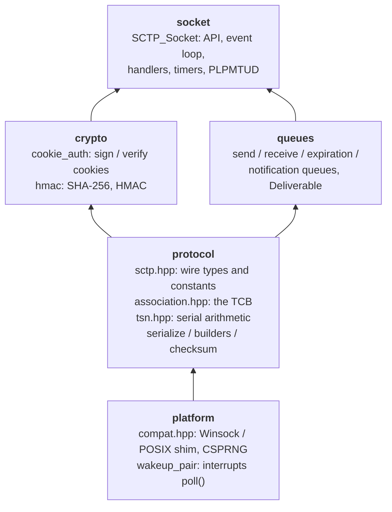
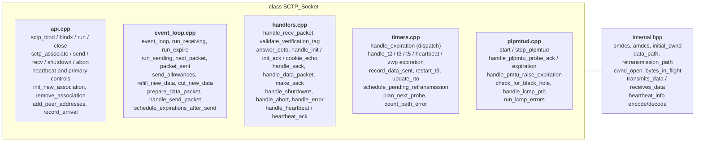
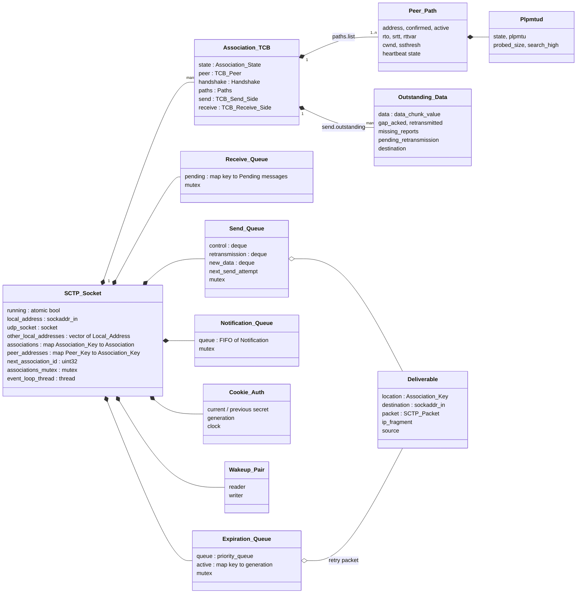
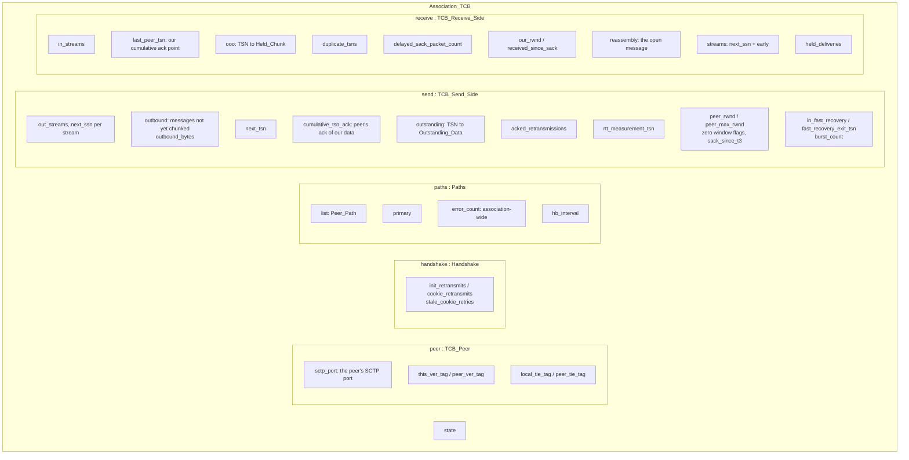
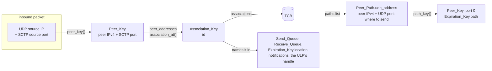
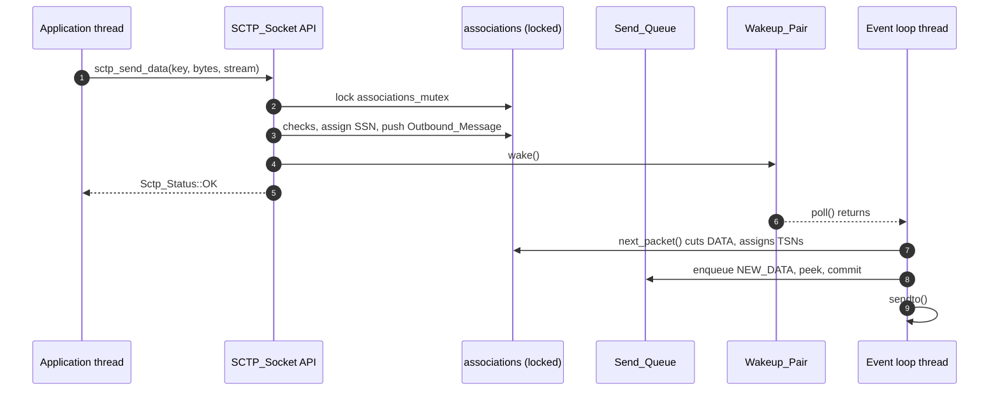
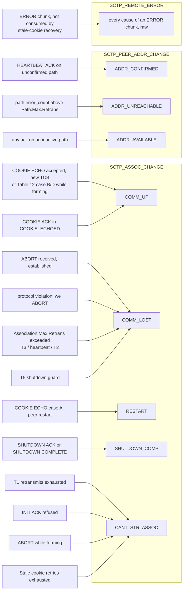

# 1. Architecture

This document covers how the code is laid out, what owns what, and where each
public call goes. The later documents look at each subsystem in detail.

- [Module layers](#module-layers)
- [Directory map](#directory-map)
- [`SCTP_Socket` and its translation units](#sctp_socket-and-its-translation-units)
- [Ownership and data model](#ownership-and-data-model)
- [The TCB (`Association_TCB`)](#the-tcb-association_tcb)
- [Identity: association ids and peer addresses](#identity-association-ids-and-peer-addresses)
- [Public API to internals](#public-api-to-internals)
- [Notifications](#notifications)
- [Design principles](#design-principles)

---

## Module layers

The code is split into five modules. Each module may include only from the
modules below it.



| Rule | Why |
|---|---|
| A module's public headers live in `include/sctp/<module>/`, and its sources and private headers in `src/<module>/`. | Consumers get `-Iinclude` only. Internal headers never leak. |
| Public headers are included as `<sctp/queues/send_queue.hpp>`. Internal ones are included by their path under `src/`, e.g. `"protocol/serialize.hpp"`. | The include style shows straight away whether a header is public. |
| A header in `include/` must never include one from `src/`. | If it needs to, the public/private split is in the wrong place. |
| `protocol/sctp.hpp` has no platform dependencies. | The wire types can be used, and fuzzed, without sockets. |

---

## Directory map

```
include/sctp/
├── socket.hpp                 SCTP_Socket, the only class a consumer uses
├── status.hpp                 Sctp_Status: every API return code
├── protocol/
│   ├── sctp.hpp               chunk/param/cause enums, chunk value structs, §16 parameters
│   ├── association.hpp        Association (TCB), Peer_Path, Outstanding_Data, Association_Key, Peer_Key
│   └── tsn.hpp                tsn_lt/gt/..., ssn_gt, sack_acknowledges
├── queues/
│   ├── deliverable.hpp        one outbound packet + where it goes
│   ├── send_queue.hpp         three-tier outbound scheduler
│   ├── receive_queue.hpp      delivered-but-unread messages
│   ├── expiration_queue.hpp   timer heap
│   └── notification_queue.hpp ULP notifications
├── crypto/cookie_auth.hpp     Cookie_Auth
└── platform/
    ├── compat.hpp             sockets, poll, DF, ICMP errors, random_bytes
    └── wakeup_pair.hpp        loopback UDP pair

src/
├── socket/
│   ├── api.cpp                public API, bind/run/close, TCB creation and removal
│   ├── event_loop.cpp         poll loop, send pass, window gating, bundling
│   ├── handlers.cpp           every inbound chunk, DATA reception, SACK in and out
│   ├── timers.cpp             timer dispatch, T1/T2/T3/T5, heartbeats, RTO
│   ├── plpmtud.cpp            DPLPMTUD and ICMP PTB
│   └── internal.hpp           constants and helpers shared by the five above
├── protocol/                  serialize, builders, checksum
├── queues/                    the four queue implementations
├── crypto/                    cookie_auth.cpp, hmac.{hpp,cpp}
└── platform/                  wakeup_pair.cpp
```

---

## `SCTP_Socket` and its translation units

`SCTP_Socket` is one class whose member functions are spread over five `.cpp`
files, grouped by concern. They all share `src/socket/internal.hpp`, which
holds constants such as `SEND_BUFFER` and `T5_SHUTDOWN_GUARD`, plus small
inline helpers for path selection, window checks and Heartbeat Info encoding.



---

## Ownership and data model



Things to notice:

- **The queues are separate from the TCBs.** They are keyed by
  `Association_Key`, and each has its own mutex. The `Receive_Queue` in
  particular outlives the TCB, so the application can still read the data a
  peer sent before a graceful close.
- **`Deliverable` is the unit of output.** It is one SCTP packet plus the
  association it belongs to, the destination transport address, an optional
  source address, and the `ip_fragment` flag (send without DF). Both the send
  queue and the timer heap hold them: T1 timers keep the INIT or COOKIE ECHO to
  resend.
- **`Peer_Path` holds all per-destination state.** That includes the RTO
  estimator, cwnd and ssthresh, heartbeat bookkeeping, the error counter, and a
  whole `Plpmtud` search. The association only keeps what is shared across
  destinations.

---

## The TCB (`Association_TCB`)

`include/sctp/protocol/association.hpp`. Besides `state`, the TCB is five
groups, one struct each:



The group names say which side a field belongs to: `assoc.send.cumulative_tsn_ack`
is the peer's acknowledgement of *our* DATA, and `assoc.receive.last_peer_tsn`
is *our* Cumulative TSN Ack point for the peer's DATA, which the SACKs we send
carry. Congestion state other than fast recovery (cwnd, ssthresh, RTO) is per
destination, on `Peer_Path`.

Each struct gives every field its starting value: zero, or `COOKIE_WAIT`,
`HB.interval` and `RWND` where the RFC names one. `init_new_association()` only
fills in what is random or comes from the peer.

Code that needs only one side takes only that side, so a signature shows what a
function can change:

| Takes | Functions |
|---|---|
| `TCB_Receive_Side&` | `reassemble`, `read_ooo_buffer`, `assemble_early`, `order_message`, `advance_stream`, `hand_up`, `make_room`, `held_bytes`, `peer_view_of_window`, `blocked_on_cumulative_tsn`, `receive_window`, `abandon_partial_delivery` |
| `TCB_Send_Side&` | `cut_new_data` (given the AMDCS), `grow_cwnd` |
| `Association_TCB&` | everything that also needs the paths, the tags or the state |

---

## Identity: association ids and peer addresses

Identity and lookup are kept apart. An association is named by an opaque
id, and every transport address of the peer maps to that id.



| Name | Holds | Used for |
|---|---|---|
| `Association_Key` | `enum class Association_Key : uint32_t`, drawn from `next_association_id`: starts at 1 and is never reused, and `Association_Key{}` (0) names no association. A scoped enum rather than a plain `uint32_t`, so a tag, TSN or PPID cannot be passed where an id belongs, and `std::hash` works without a custom hasher. | The association's identity: `associations`, `Receive_Queue`, `Send_Queue` (`Deliverable.location`), `Expiration_Key.location`, `Notification.src`, and the handle the ULP gets from `sctp_associate` or a COMM UP notification |
| `Peer_Key` from `peer_key(addr, sctp_port)` | peer IPv4 + peer **SCTP** port. The UDP port is dropped. | Key of `peer_addresses`, which maps **every** peer address, the first one included, to its association. `association_at()` looks it up and returns id 0 if the address is unknown. |
| `Peer_Key` from `path_key(addr)` | peer IPv4 only, port 0 | `Expiration_Key.path`, naming one destination for per-path timers (T3-rtx, HEARTBEAT, PLPMTU_PROBE, PMTU_RAISE) |
| `Peer_Path.udp_address` | peer IPv4 + the **UDP encapsulation port** it last sent from | The `sendto()` destination. Not a key. |

Lifecycle of the mapping:

- **Created**: `sctp_associate()` and a valid COOKIE ECHO with no matching TCB
  draw a fresh id, then call `add_peer_addresses()`, which maps each address
  (the first included) to it. INIT ACK, collision (case B) and restart (case A)
  add addresses in the same way.
- **Removed**: `forget_peer_addresses(key, assoc)` walks the TCB's own
  address list. It removes an entry only if the entry still maps to this
  association, so an address another association already held is never taken
  from it. `remove_association()` and a restart call it.
- **The primary is a path choice, not an identity.** `sctp_set_primary()`
  changes `paths.primary` only. The id does not change.
- **The peer's SCTP port** is stored on the TCB (`Association_TCB::peer.sctp_port`, host
  order). Every packet the association originates is addressed to it.
- **Passive associations**: a ULP that did not call `sctp_associate` learns the
  id from the COMM UP notification's `src`.

Within one association, two transport addresses are the same destination if
their IP matches (`same_destination()`). The SCTP port belongs to the
association; the UDP port is only where to send encapsulated packets. See
[Paths](07-paths.md#addresses-ports-and-keys).

---

## Public API to internals

Every public call except the receive calls takes `associations_mutex`, works
on the TCB, and then either enqueues packets or wakes the event loop. Nothing
in the API does network I/O directly.



| Call | Preconditions / refusals | What it does internally |
|---|---|---|
| `sctp_bind(ip, port)` | Not running | Calls `sctp_bindx({ip}, port)`. |
| `sctp_bindx(ips, port)` | Not running. A wildcard address must be bound alone. | Binds the first address on `udp_socket`, then opens one more non-blocking, DF-set UDP socket per extra address at the same port (`other_local_addresses`). |
| `sctp_run()` | Not already running | Opens the `Wakeup_Pair` and starts `event_loop()` on a new thread. |
| `sctp_close()` | Safe to call at any time, and called by the destructor | `close_associations()` ABORTs every TCB and waits up to `CLOSE_DRAIN_TIMEOUT` (100 ms) for the send queue to drain. It then stops and joins the loop, clears the queues and closes the sockets. |
| `sctp_associate(ip, port, out, udp_port)` | `NOT_RUNNING`, `INVALID_ADDRESS`, `ASSOCIATION_EXISTS` (the address already maps to an association) | Draws a fresh id, `init_new_association()` creates a TCB in `COOKIE_WAIT` and the address is mapped to the id, then an INIT is enqueued. T1-init is armed when the INIT actually leaves (`schedule_expirations_after_send`). |
| `sctp_send_data(key, bytes, stream, unordered, ppid)` | `NO_ASSOCIATION`, `NOT_ESTABLISHED`, `SHUTTING_DOWN`, `EMPTY_MESSAGE`, `INVALID_STREAM`, `QUEUE_FULL` | Assigns an SSN (ordered only), appends an `Outbound_Message`, and wakes the loop. No TSN is assigned yet: see [late TSN assignment](05-outbound.md#late-tsn-assignment). |
| `sctp_recv_data(buf, ...)` / `sctp_recv_data_from(key, buf, ...)` | Returns 0 when there is nothing to read | Reads at most one message from `Receive_Queue`, then takes the lock to call `maybe_send_window_update()`. |
| `sctp_shutdown(key)` | `NO_ASSOCIATION`, `SHUTTING_DOWN` | While the association is still forming, the TCB is dropped without a word. Otherwise the state becomes `SHUTDOWN_PENDING` and `do_next_shutdown_step()` runs. |
| `sctp_abort(key, reason)` | `NO_ASSOCIATION` | `remove_association()` first, which purges queued DATA. Then an ABORT with a User-Initiated Abort cause is enqueued, truncated to fit the AMDCS. Nothing is sent in `COOKIE_WAIT` because there is no peer tag yet. |
| `sctp_recv_notification()` | none | Pops `Notification_Queue`. |
| `sctp_change_heartbeat(key, dest, enabled, interval)` | `NO_ASSOCIATION`, `UNKNOWN_DESTINATION` | Toggles `hb_enabled` on one path. A new interval applies to all paths. Re-plans and re-arms HEARTBEAT timers. |
| `sctp_request_heartbeat(key, dest)` | `+ NOT_ESTABLISHED / SHUTTING_DOWN` | Enqueues a HEARTBEAT immediately and arms that path's timer. |
| `sctp_set_primary(key, dest)` | `+ UNCONFIRMED_DESTINATION` | Sets `paths.primary`. |

`Sctp_Status` values are defined in `include/sctp/status.hpp`.

---

## Notifications

`Notification_Queue` is a mutex-guarded FIFO. Each `Notification` carries
the `Association_Key` and a variant payload.



Two teardowns deliberately produce **no** notification. `sctp_abort()` is
asked for by the ULP, so it already knows. `sctp_shutdown()` before the
association is established drops the TCB silently, as Linux does.

---

## Design principles

These choices recur throughout the code. Knowing them makes most functions
easier to read.

1. **One lock over all TCBs.** `associations_mutex` guards `associations` and
   `peer_addresses`, so a handler never needs to think about lock order between
   associations. The queues each have a small internal mutex, so the
   application can read data and notifications without contending for the big
   lock. See [Concurrency](02-concurrency.md).
2. **Only the event loop sends.** The API and the handlers *enqueue*
   `Deliverable`s, and `run_sending()` is the only caller of `sendto()`. It
   runs `sendto()` outside every lock.
3. **TSNs are assigned late.** A message is cut into DATA chunks, and given its
   TSNs, only when a packet can actually carry it under the current cwnd and
   rwnd. At most one new-DATA packet per association is built ahead of time, so
   TSNs go on the wire in order.
4. **Packets are rebuilt rather than replayed** whenever their content depends
   on current state: a resent SHUTDOWN carries the current Cumulative TSN Ack,
   and retransmissions are re-bundled per destination. INIT and COOKIE ECHO are
   the exception: their bytes are fixed, so the T1 timer keeps the packet itself.
5. **Timers are cancelled by generation, not by removal.** Each `schedule()`
   stamps a new generation, and a stale heap entry is discarded when it reaches
   the top. See [Timers](06-timers.md#the-expiration-queue).
6. **The responder holds no state before COOKIE ECHO.** Everything it needs
   is in the signed State Cookie. See [Cookies](10-cookies-and-crypto.md).
7. **Received data outlives the TCB.** `Receive_Queue` is keyed separately, so
   a graceful close does not discard data the ULP has not read yet.
8. **No machinery beyond the RFC.** There is no logger framework and no
   configuration system. Errors go to `std::cerr`, and tunables are `constexpr`
   in `sctp.hpp` (the §16 values) and `internal.hpp`.
