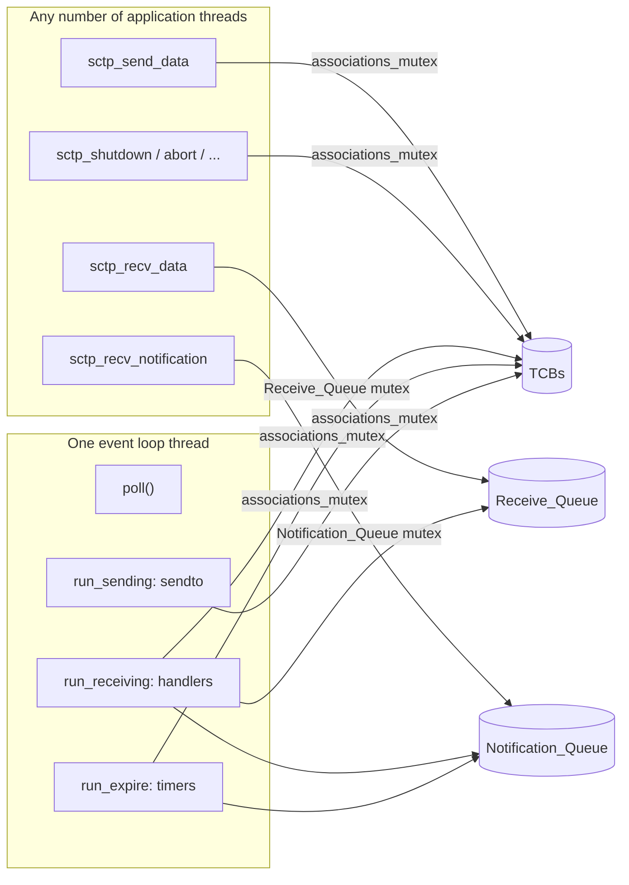
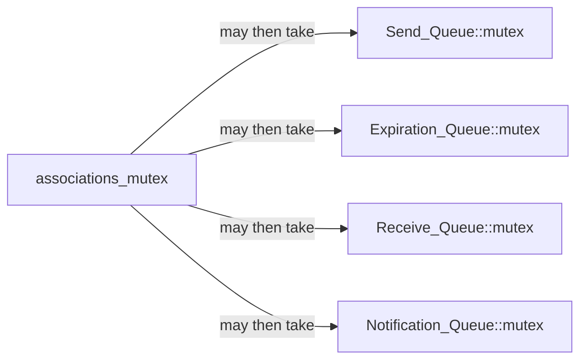
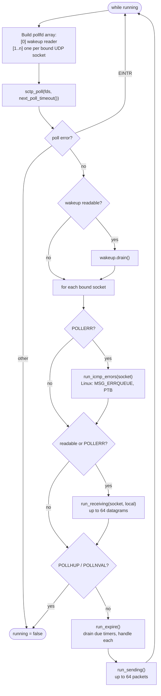
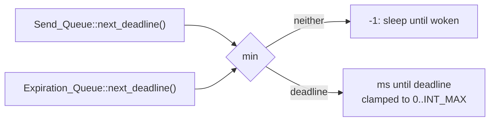
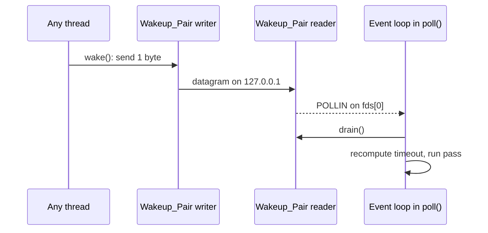
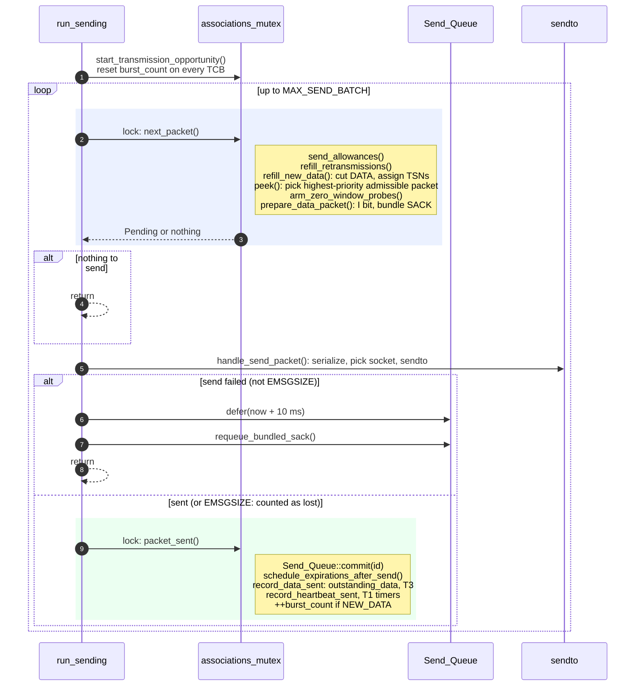
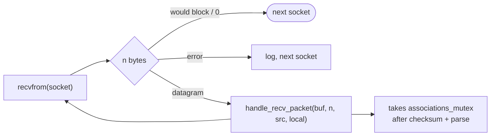
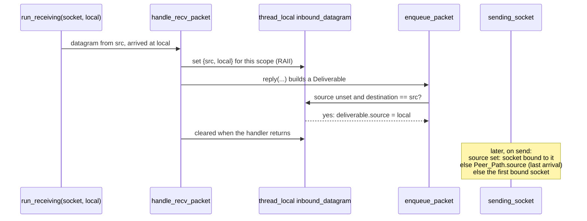
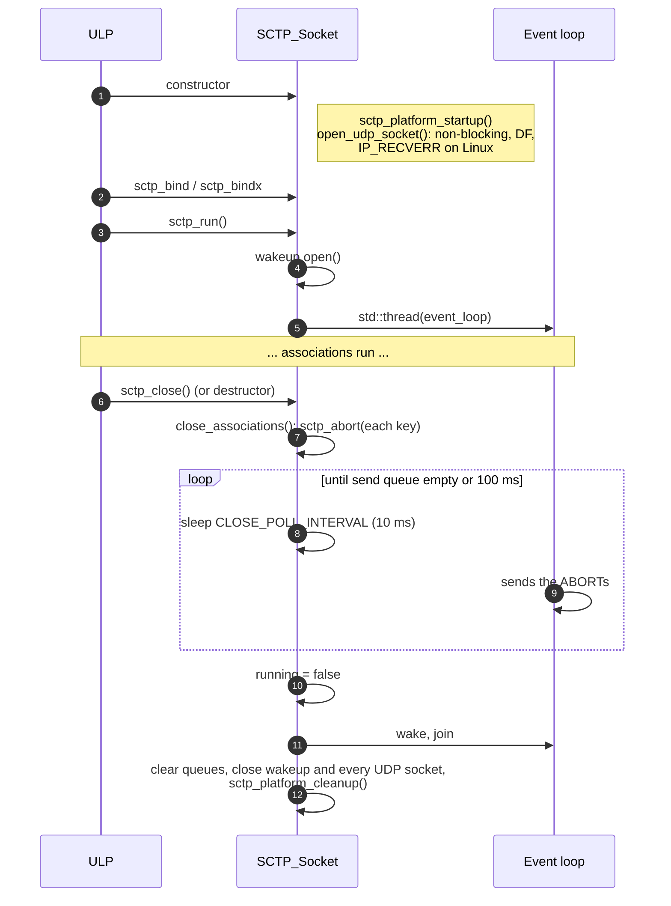

# 2. Concurrency and the event loop

Sources: `src/socket/event_loop.cpp`, `src/socket/api.cpp`,
`src/platform/wakeup_pair.cpp`, `include/sctp/queues/*.hpp`.

- [Threads](#threads)
- [Locks](#locks)
- [One pass of the event loop](#one-pass-of-the-event-loop)
- [Sleeping: the poll timeout](#sleeping-the-poll-timeout)
- [Waking: the wakeup pair](#waking-the-wakeup-pair)
- [The send pass: peek, send, commit](#the-send-pass-peek-send-commit)
- [The receive pass](#the-receive-pass)
- [Replies leave from the address the packet arrived at](#replies-leave-from-the-address-the-packet-arrived-at)
- [Startup and close](#startup-and-close)
- [Error handling inside the loop](#error-handling-inside-the-loop)

---

## Threads

There is exactly one event-loop thread per `SCTP_Socket`, started by
`sctp_run()`. It is the only thread that:

- calls `recvfrom()` / `recvmsg(MSG_ERRQUEUE)`,
- calls `sendto()`,
- runs timer expirations,
- pops the send queue (which makes the `peek`/`commit` split safe, see below).

Application threads only edit TCBs under the lock, push to queues, and
wake the loop.

---

## Locks

| Lock | Guards | Taken by |
|---|---|---|
| `SCTP_Socket::associations_mutex` | `associations`, `peer_addresses`, every `Association` and `Peer_Path` | Every public API call except the receive calls and `sctp_recv_notification`. On the loop side: `handle_recv_packet`, `handle_expiration`, `handle_icmp_ptb`, `next_packet`, `packet_sent`, `start_transmission_opportunity`, briefly `sending_socket`, and `finish_read` after a receive. |
| `Send_Queue::mutex` | the three deques, back-off time | Internally, by each `Send_Queue` method |
| `Expiration_Queue::mutex` | heap + `active` map | Internally, by each method |
| `Receive_Queue::mutex` | per-association messages | Internally, by each method |
| `Notification_Queue::mutex` | FIFO | Internally, by each method |

### Lock order

A queue's mutex is always the **innermost** lock. Queue methods never call
back into `SCTP_Socket`, so the reverse order cannot happen. Two rules follow
from this:

1. **Member functions assume the lock is held.** Apart from the entry points
   in the table above, every `SCTP_Socket` member that touches an association
   (`find_tcb`, `handle_*`, `restart_t3`, `make_sack`, ...) expects the caller
   to already hold `associations_mutex`. It is never taken twice.
2. **The wakeup is outside the queue lock.** `enqueue_packet()`,
   `schedule_expiration()` and `cancel_expiration()` wrap the queue call and
   *then* call `wake_event_loop()`. The `Expiration_Queue` header says it
   plainly: nothing in the queue wakes the loop by itself.

### Why the receive calls do not take the big lock first

`sctp_recv_data()` reads `Receive_Queue` with only that queue's mutex held.
`finish_read()` then takes `associations_mutex` to check whether the read
opened the window enough to send a window-update SACK
(`maybe_send_window_update`). A blocked reader therefore never holds up packet
processing.

---

## One pass of the event loop

`SCTP_Socket::event_loop()`:

Each pass handles three kinds of work, always in this order:

1. **Inbound**: up to `MAX_RECEIVE_BATCH` (64) datagrams per readable socket.
2. **Timers**: every timer whose deadline has passed, from
   `Expiration_Queue::drain_expired(now)`.
3. **Outbound**: up to `MAX_SEND_BATCH` (64) packets.

Doing inbound before outbound means a SACK that arrived in this pass has
already updated cwnd and rwnd by the time the send pass decides what fits.

---

## Sleeping: the poll timeout

- `Expiration_Queue::next_deadline()` skips (and pops) stale entries, so it
  returns the earliest **live** timer.
- `Send_Queue::next_deadline()` returns `next_send_attempt`. This is "now"
  unless a failed `sendto()` set a back-off. It returns `nullopt` when the
  queue holds only new DATA that the last `peek()` refused (`new_data_blocked`).
  That stops the loop from spinning on a closed window. What reopens the window
  (a SACK arriving, or a timer) wakes the loop by itself.

---

## Waking: the wakeup pair

`Wakeup_Pair` is two loopback UDP sockets. The reader is bound to an ephemeral
port on 127.0.0.1, and the writer is `connect()`ed to it. `wake()` sends one
byte, and `drain()` reads until it would block.

A self-pipe would not work on Windows: `WSAPoll()` only accepts sockets. A
UDP pair works with both POSIX `poll()` and `WSAPoll()`. Both ends are
non-blocking, so a flood of wakes cannot block the caller. Extra bytes are
harmless because `drain()` reads them all.

Wakes are sent from: `enqueue_packet`, `schedule_expiration`,
`cancel_expiration`, `cancel_expirations`, `sctp_send_data`, and `sctp_close`.

---

## The send pass: peek, send, commit

`run_sending()` makes up to 64 iterations. Each iteration takes the big lock
twice for short periods, and calls `sendto()` with no lock held.

### Why `peek` and `commit` are separate

`peek()` returns a *copy* of the head packet without removing it. If
`sendto()` fails with EAGAIN, nothing is lost: the packet stays at the head,
`defer()` makes `next_deadline()` report "retry in `SEND_RETRY_DELAY`" (10 ms),
and the loop returns.

The lock is released between `peek()` and `commit()`, so another thread may
`purge()` that association in between (for example the ULP calls
`sctp_abort`). `commit()` looks the packet up by its `id`. If it is not
found, the purge already dropped it, which is the right outcome.

### Why the SACK is re-queued on failure

`prepare_data_packet()` may move a delayed SACK *into* the outgoing DATA
packet, and cancels the delayed-SACK timer when it does. That bundled SACK
exists only in the `Pending` copy, not in the queued packet. So if the send
fails, `requeue_bundled_sack()` enqueues it again as a control packet, or it
would be lost.

### `EMSGSIZE` counts as sent

A packet too large to leave with DF set is treated as sent and then lost on
the wire. Retrying would fail the same way, and for a PLPMTU probe this loss is
exactly what the search needs to learn from. See [PMTU](08-pmtu.md).

---

## The receive pass

`handle_recv_packet` verifies the CRC-32C and parses the packet *before* it
takes the lock. Malformed or corrupted packets therefore never contend for it.
The whole pipeline is described in [Inbound](04-inbound.md).

`run_icmp_errors()` (Linux only) drains the socket's error queue in the same
way, at most 64 entries per pass, and hands each ICMP "fragmentation needed"
to `handle_icmp_ptb()`.

---

## Replies leave from the address the packet arrived at

When several local addresses are bound, each one has its own UDP socket. A
reply must leave from the address the peer sent to, because that is the only
one it may know. The code does this with a `thread_local` pointer:

`record_arrival()` also stores the arrival address in `Peer_Path.source`, so
packets the stack starts on its own (DATA, heartbeats) go out from the same
address. INIT is the exception: it proves nothing about where the peer is, so
it does not update `Peer_Path`.

---

## Startup and close

`sctp_close()` is idempotent and is also called by the destructor. The drain
wait gives the ABORTs a chance to reach the wire before the sockets close.

---

## Error handling inside the loop

| Failure | Response |
|---|---|
| `poll()` interrupted | Retry the pass. |
| `poll()` other error, or `POLLHUP`/`POLLNVAL` on any socket, or an error on the wakeup socket | Log, set `running = false`, and leave the loop. |
| Exception from `handle_recv_packet` | Caught per datagram and logged. The next datagram is processed. |
| Exception from `handle_expiration` | Caught per timer and logged. The other timers still run. |
| `sendto()` EAGAIN / other error | `defer()` 10 ms and re-queue any bundled SACK. The packet stays queued. |
| `sendto()` EMSGSIZE | Treated as sent and lost. |
| Control queue at `MAX_QUEUED_CONTROL` (256) | New control packets are dropped, as if lost on the wire. |

Only two failures reach the ULP as exceptions: `random_bytes` throwing, which
means the OS CSPRNG is broken, and `sctp_run()` rethrowing when the thread
cannot be created.
