# 3. Association lifecycle

Sources: `src/socket/handlers.cpp` (`handle_init`, `handle_init_ack`,
`handle_cookie_echo`, `handle_cookie_ack`, `handle_error`, `handle_shutdown*`,
`handle_abort`, `abort_association`, `do_next_shutdown_step`),
`src/socket/api.cpp` (`sctp_associate`, `sctp_shutdown`, `sctp_abort`,
`init_new_association`, `remove_association`), `src/socket/timers.cpp` (T1, T2, T5).

- [State machine](#state-machine)
- [Which Verification Tag each chunk carries](#which-verification-tag-each-chunk-carries)
- [Initiating: the four-way handshake](#initiating-the-four-way-handshake)
- [Responding: no state until the cookie returns](#responding-no-state-until-the-cookie-returns)
- [`handle_init` in detail](#handle_init-in-detail)
- [`handle_init_ack` in detail](#handle_init_ack-in-detail)
- [`handle_cookie_echo`: Table 12](#handle_cookie_echo-table-12)
- [INIT collision](#init-collision)
- [Peer restart](#peer-restart)
- [Stale cookie recovery](#stale-cookie-recovery)
- [Graceful shutdown](#graceful-shutdown)
- [Abort and teardown](#abort-and-teardown)

---

## State machine

`Association_State` in `association.hpp`. CLOSED is not a state in the code:
it means "no entry in `associations`".

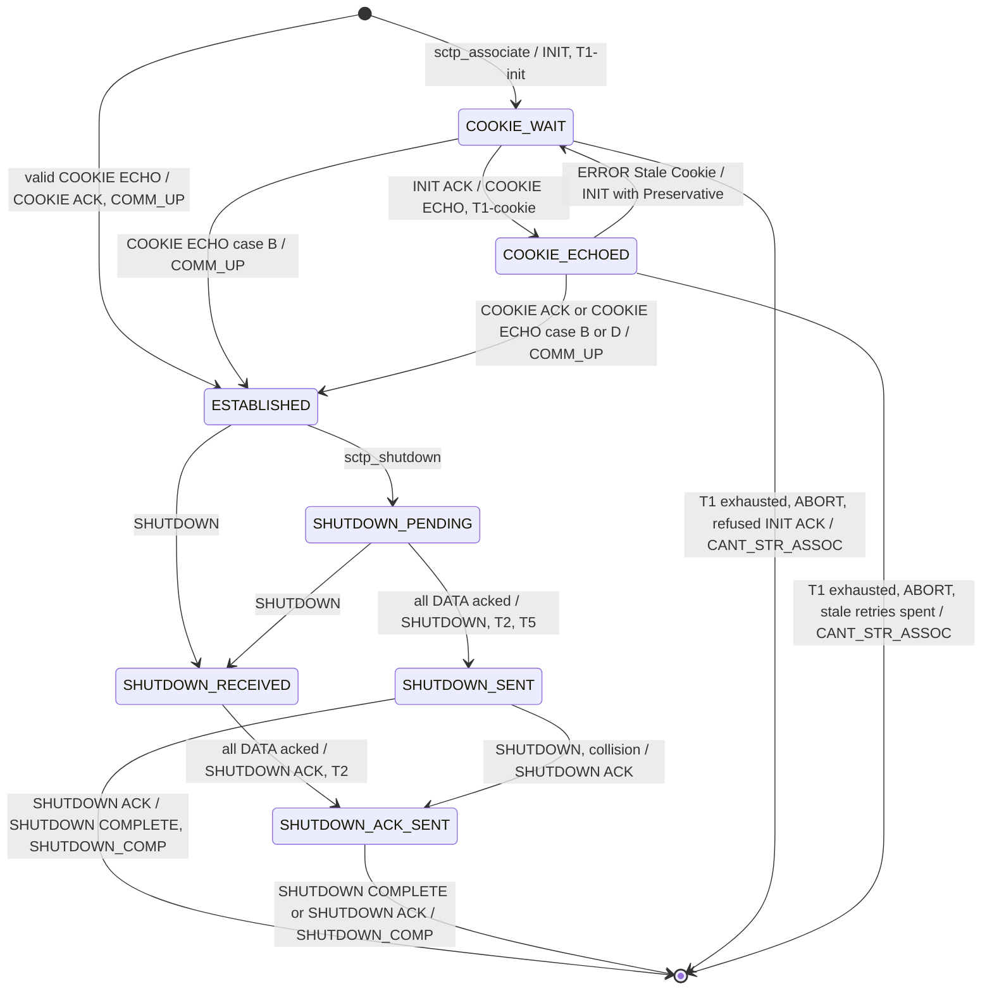

Not drawn, to keep the diagram readable: from **every** state, a valid ABORT,
`sctp_abort()`, a protocol violation, or Association.Max.Retrans being exceeded
removes the TCB. The notification is `COMM_LOST`, or `CANT_STR_ASSOC` while
forming. From `SHUTDOWN_SENT` and `SHUTDOWN_ACK_SENT`, T5 does the same.

### What each state allows

The predicates in `internal.hpp` are the single source of truth:

| State | `is_forming` | `transmits_data` (send DATA, process SACK, heartbeats) | `receives_data` (accept DATA, send SACK) | `sctp_send_data` |
|---|:-:|:-:|:-:|:-:|
| `COOKIE_WAIT` | ✔ | | | `NOT_ESTABLISHED` |
| `COOKIE_ECHOED` | ✔ | | | `NOT_ESTABLISHED` |
| `ESTABLISHED` | | ✔ | ✔ | ✔ |
| `SHUTDOWN_PENDING` | | ✔ | ✔ | `SHUTTING_DOWN` |
| `SHUTDOWN_SENT` | | | ✔ | `SHUTTING_DOWN` |
| `SHUTDOWN_RECEIVED` | | ✔ | | `SHUTTING_DOWN` |
| `SHUTDOWN_ACK_SENT` | | | | `SHUTTING_DOWN` |

---

## Which Verification Tag each chunk carries

| Sent chunk | Header Verification Tag | T bit | Built in |
|---|---|:-:|---|
| INIT | `0` | | `build_init` |
| INIT ACK | the peer's Initiate Tag from the INIT | | `handle_init` |
| COOKIE ECHO, COOKIE ACK, DATA, SACK, HEARTBEAT, HEARTBEAT ACK, SHUTDOWN, SHUTDOWN ACK, ERROR | `peer_ver_tag` | | `packet_to`, `reply` |
| ABORT inside an association | `peer_ver_tag` | 0 | `sctp_abort`, `abort_association`, T5 |
| ABORT answering an OOTB packet | the received header's tag, reflected | 1 | `answer_ootb` |
| ABORT answering an INIT with Initiate Tag 0 | the received header's tag, reflected | 1 | `handle_init` |
| ABORT refusing an INIT ACK with Initiate Tag 0 | the received header's tag, reflected | 1 | `handle_init_ack` |
| SHUTDOWN COMPLETE inside an association | `peer_ver_tag` | 0 | `handle_shutdown_ack` |
| SHUTDOWN COMPLETE answering an OOTB SHUTDOWN ACK | the received header's tag, reflected | 1 | `answer_ootb` |

On the receive side these are checked by `validate_verification_tag()`. See
[Inbound: tag validation](04-inbound.md#verification-tag-validation).

---

## Initiating: the four-way handshake

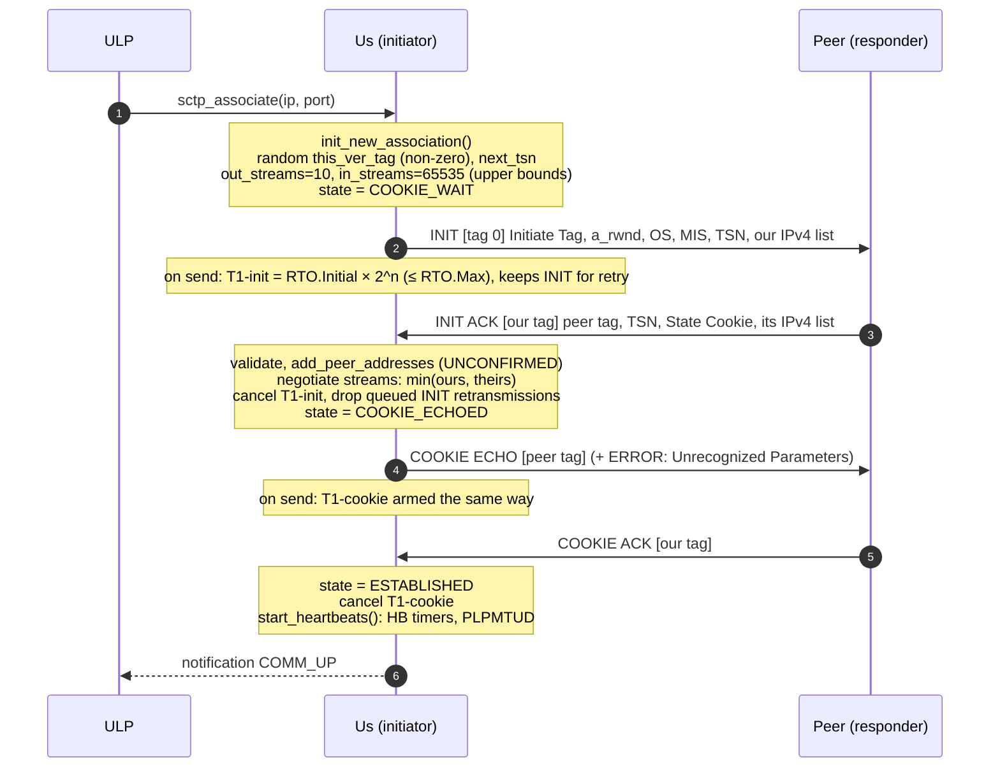

### T1 retransmission

T1 does **not** use the path RTO. It uses `RTO_INITIAL` (1 s), doubled per
retransmission and capped at `RTO_MAX` (60 s). The doubling is applied when
the timer is armed in `schedule_expirations_after_send`:

```
retransmits:  0    1    2    3    4     5     6     7     8
T1 delay:     1s   2s   4s   8s   16s   32s   60s   60s   60s   -> then CANT_STR_ASSOC
```

When it expires, `handle_expiration` checks that the TCB is still in the state
the timer belongs to (`COOKIE_WAIT` for T1-init, `COOKIE_ECHOED` for
T1-cookie). If `MAX_INIT_RETRANSMITS` (8) has been reached, the association is
removed with `CANT_STR_ASSOC`. Otherwise the stored packet is re-enqueued at
`RETRANSMISSION` priority.

---

## Responding: no state until the cookie returns

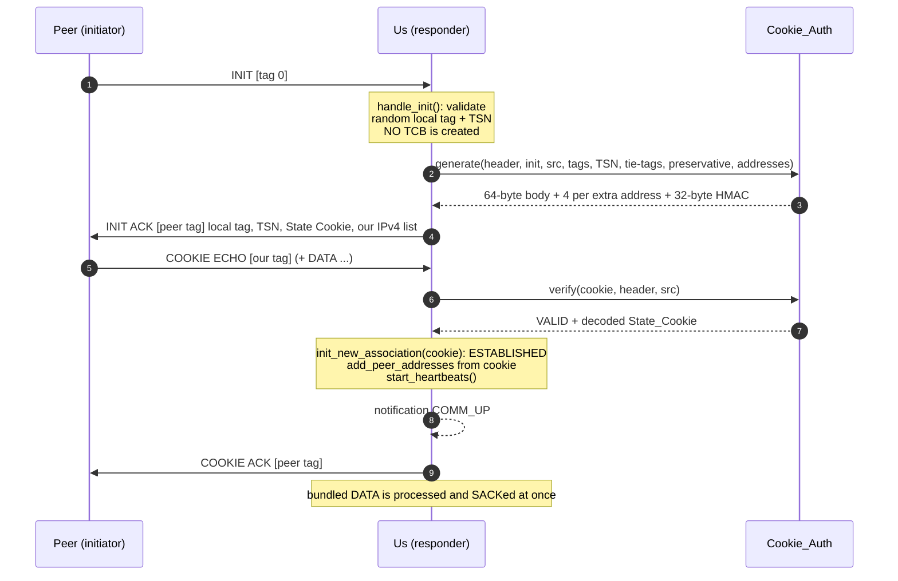

The responder holds no memory per INIT, which is the SYN-flood defence of
§5.1.3. The cookie carries everything `init_new_association(const
State_Cookie&)` needs: both tags, both initial TSNs, the peer's a_rwnd, the
stream counts both sides offered, the tie-tags, and the peer's address list.
See [State cookies](10-cookies-and-crypto.md).

---

## `handle_init` in detail

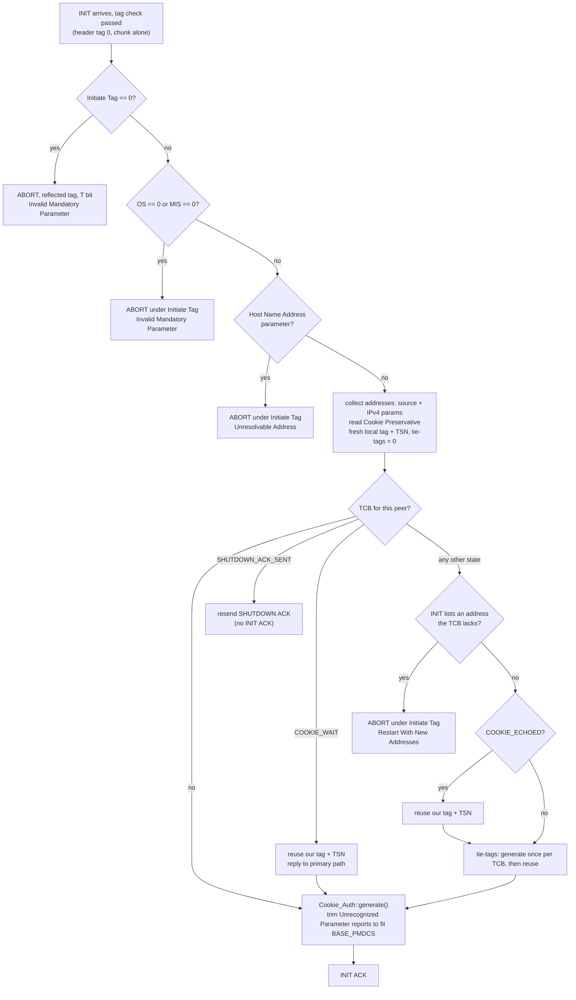

An existing TCB is **never changed** by an INIT, apart from generating its
tie-tags once. An INIT carries no proof of where it came from, so all
decisions are deferred to the COOKIE ECHO.

---

## `handle_init_ack` in detail

Accepted only in `COOKIE_WAIT`. Any other INIT ACK is silently dropped.

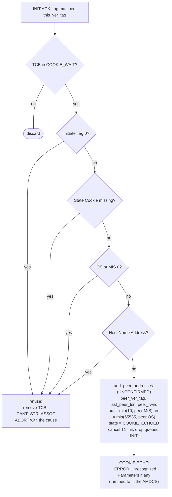

The refusal ABORT goes out under the INIT ACK's Initiate Tag. If that tag is
0, the ABORT reflects the received header tag and sets the T bit.

---

## `handle_cookie_echo`: Table 12

The COOKIE ECHO is the only chunk that may arrive under a tag the TCB does not
hold. `validate_verification_tag()` lets it through, and
`handle_recv_packet` runs it **first**. If it returns `false`, the rest of the
packet is discarded. `handle_cookie_echo` also *re-keys* the packet: `key`
becomes the association named in the cookie.

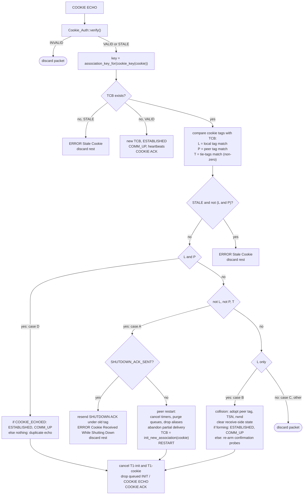

| Case | Local tag | Peer tag | Tie-tags | Meaning | Action |
|:-:|:-:|:-:|:-:|---|---|
| A | ✗ | ✗ | match | Peer restarted | Replace the TCB, notify `RESTART` |
| B | ✔ | ✗ | any | Simultaneous INITs crossed | Adopt the peer's new parameters |
| C | ✗ | ✔ | 0 | Late cookie from an old attempt | Silently discard |
| D | ✔ | ✔ | any | Our COOKIE ACK was lost | Re-ACK, and enter `ESTABLISHED` if still `COOKIE_ECHOED` |

A Tie-Tag of 0 means "none" and never matches.

---

## INIT collision

Both ends call `sctp_associate()` at the same time:

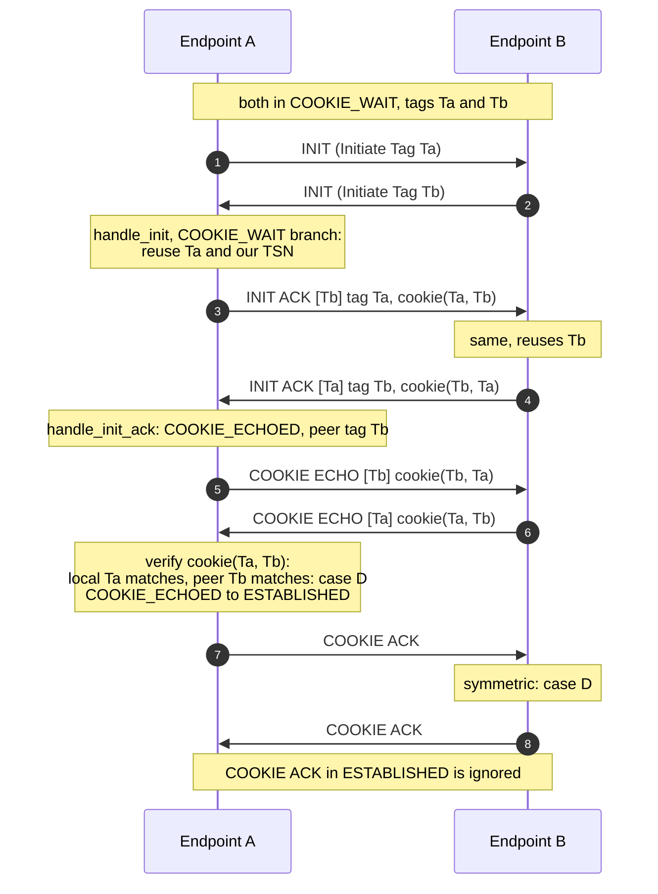

Because both sides reuse their tags in `COOKIE_WAIT`, the crossing cookies
match as case D. Case B handles the orderings where one side has already
learned a different peer tag.

---

## Peer restart

The peer crashes and comes back while we still hold an `ESTABLISHED` TCB:

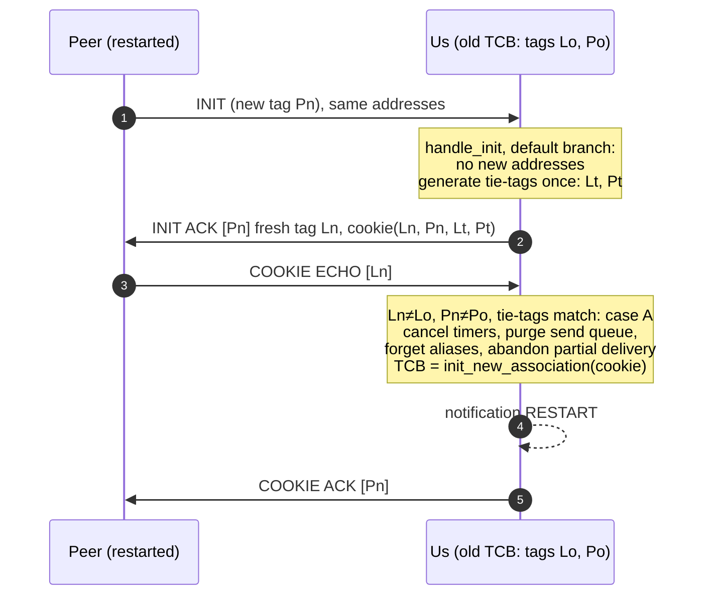

If the restarted peer lists an address the old TCB does not have, `handle_init`
refuses with ABORT + *Restart of an Association with New Addresses* (cause 11).
The ABORT lists the new addresses.

---

## Stale cookie recovery

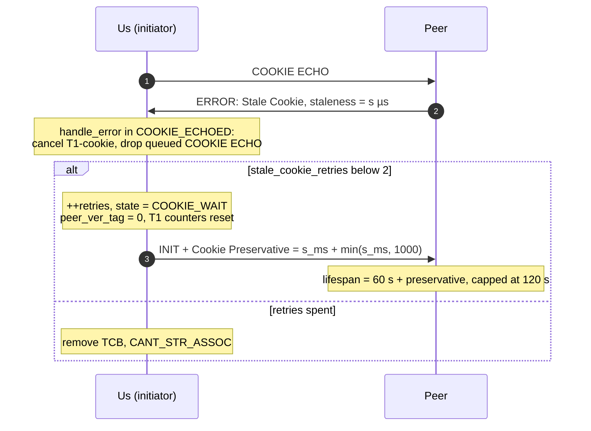

`s_ms` is `staleness_us / 1000 + 1`. The INIT reuses our original tag and TSN.
Every other ERROR is passed to the ULP as `SCTP_REMOTE_ERROR` with all its
causes raw, including codes the stack does not act on.

---

## Graceful shutdown

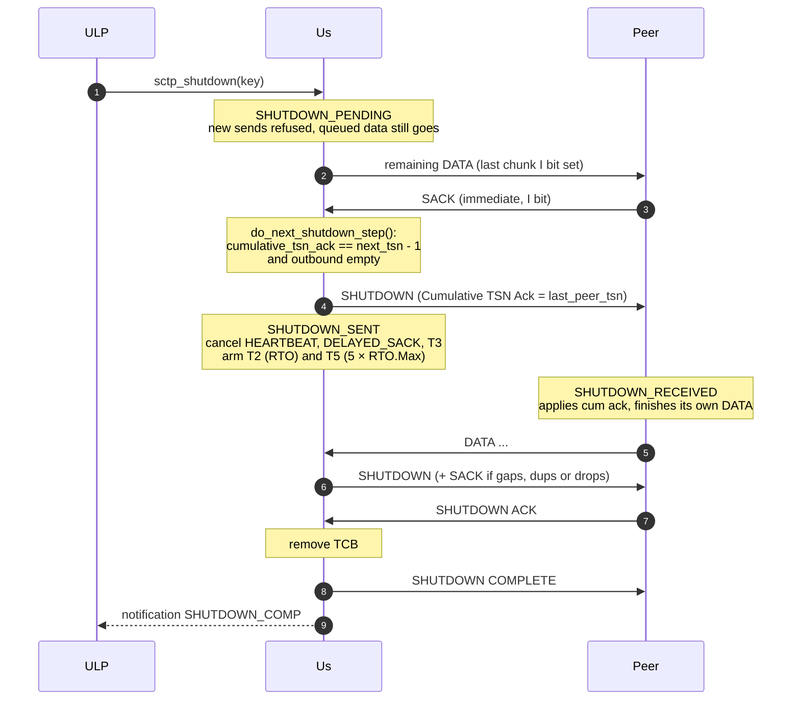

Details that are easy to miss:

- **Readiness is cumulative.** `do_next_shutdown_step` compares
  `cumulative_tsn_ack` against `next_tsn - 1` and requires `outbound` to be
  empty. Checking that `outstanding_data` is empty would not be enough: DATA
  can be in the send queue with a TSN but no outstanding entry yet.
- **SHUTDOWN is treated as a SACK without gap blocks.** `handle_shutdown`
  removes outstanding data up to the Cumulative TSN Ack. Chunks that were
  gap-acked stay gap-acked: a missing block is not reneging (§3.3.8). If the
  ack covers TSNs we never sent, the association is aborted with Protocol
  Violation.
- **In `SHUTDOWN_SENT`, every packet from the peer resets the clock.**
  `error_count = 0` and T2 restarts. T5 is armed once and never pushed back,
  so it is the bound the peer cannot extend.
- **A resent SHUTDOWN is rebuilt.** T2 builds a new SHUTDOWN with the current
  `last_peer_tsn`, backs off the data path's RTO, and counts an association
  error.
- **Shutdowns can collide.** A SHUTDOWN arriving in `SHUTDOWN_SENT` moves to
  `SHUTDOWN_ACK_SENT` and answers with SHUTDOWN ACK. A SHUTDOWN ACK arriving in
  `SHUTDOWN_ACK_SENT` completes the shutdown in the same way as in
  `SHUTDOWN_SENT`.
- **No HEARTBEAT ACK is sent** in `SHUTDOWN_SENT` or `SHUTDOWN_ACK_SENT`.

---

## Abort and teardown

### `remove_association(key, state?)`

Every teardown goes through this function, in this order:

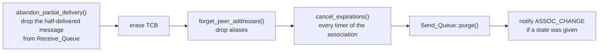

Any ABORT is enqueued **after** `remove_association()` returns. Otherwise the
purge would drop it together with the DATA that must not be sent alongside it.
Messages already complete in `Receive_Queue` survive, so the ULP can still
read them.

### What triggers an abort

| Trigger | Where | Cause sent | Notification |
|---|---|---|---|
| ULP `sctp_abort(key, reason)` | `api.cpp` | User-Initiated Abort (12) with the reason | none |
| SACK acknowledges a TSN not yet sent | `handle_sack` | Protocol Violation (13) | `COMM_LOST` |
| SHUTDOWN Cumulative TSN Ack ≥ `next_tsn` | `handle_shutdown` | Protocol Violation (13) | `COMM_LOST` |
| DATA chunk with no user data | `handle_data_packet` | No User Data (9) + the TSN | `COMM_LOST` |
| DATA framing broken (B/E bits, stream or SSN mismatch inside a message) | `handle_data_packet` | Protocol Violation (13) | `COMM_LOST` |
| T5 shutdown guard | `handle_t5_expiration` | none | `COMM_LOST` |
| Association.Max.Retrans exceeded (T3, data-path heartbeat, T2) | `timers.cpp` | **no ABORT**: the peer is unreachable | `COMM_LOST` |
| ABORT received | `handle_abort` | | `COMM_LOST`, or `CANT_STR_ASSOC` while forming |

`abort_association()` sends the ABORT only when `peer_ver_tag != 0`. In
`COOKIE_WAIT` there is no tag the peer would accept.
