# 4. Inbound path

Sources: `src/socket/handlers.cpp`. Entry point: `SCTP_Socket::handle_recv_packet`.

- [Pipeline](#pipeline)
- [Finding the association](#finding-the-association)
- [Verification Tag validation](#verification-tag-validation)
- [Out-of-the-blue packets](#out-of-the-blue-packets)
- [Unrecognized chunk types](#unrecognized-chunk-types)
- [Dispatch](#dispatch)
- [DATA reception](#data-reception)
  - [Receive-side data structures](#receive-side-data-structures)
  - [Per-chunk processing](#per-chunk-processing)
  - [Receive buffer and drop policy](#receive-buffer-and-drop-policy)
  - [Reassembly and ordering](#reassembly-and-ordering)
  - [Early assembly: a gap blocks only its own stream](#early-assembly-a-gap-blocks-only-its-own-stream)
  - [Partial delivery](#partial-delivery)
  - [Worked example](#worked-example)
- [Acknowledging: when to SACK](#acknowledging-when-to-sack)
- [Building a SACK](#building-a-sack)
- [The advertised window](#the-advertised-window)
- [HEARTBEAT](#heartbeat)

---

## Pipeline

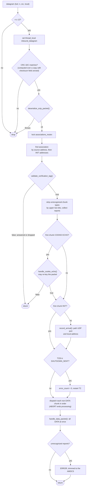

The checksum and parse happen **before** the lock is taken. Corrupt input
therefore never touches association state and never contends for the lock.

---

## Finding the association

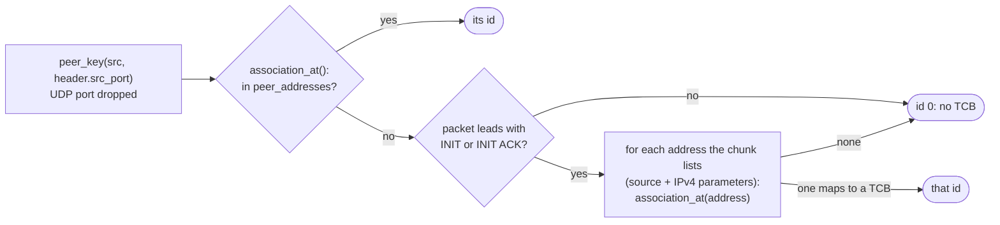

Every peer address is in `peer_addresses`, so one lookup covers all of them.
The INIT step means that an INIT or INIT ACK sent from a peer address we have
not seen yet still finds the TCB, as long as it lists an address we know.
That is how a restart or collision arriving from an alternate address is
matched to the existing association.

---

## Verification Tag validation

`validate_verification_tag(pkt, key, src)` returns `true` ("accept" below) when
the packet goes on to dispatch, and `false` ("drop") when it goes no further. Where §8.4 or §8.5 requires an answer, it has already been
enqueued by then.

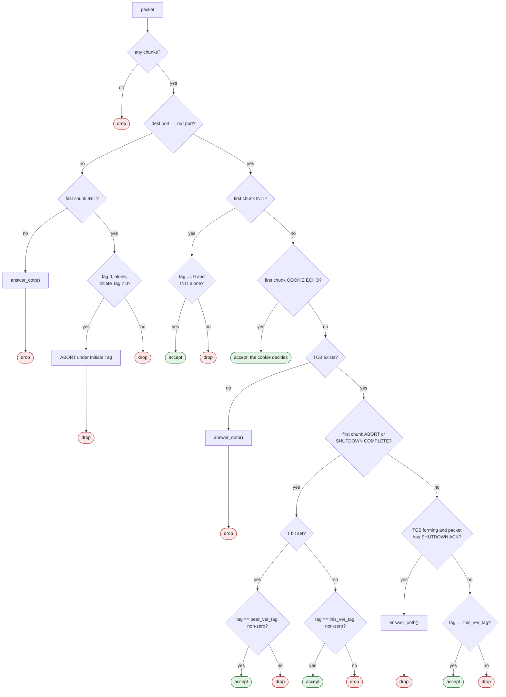

The SCTP port equals the UDP port this endpoint is bound to: no endpoint here
listens on any other SCTP port.

---

## Out-of-the-blue packets

`answer_ootb()` applies the §8.4 rules in order. The first rule that matches
wins:

| Packet contains | Response |
|---|---|
| an ABORT anywhere | nothing |
| a SHUTDOWN ACK | SHUTDOWN COMPLETE, reflected tag, T bit |
| an ERROR with Stale Cookie, a SHUTDOWN COMPLETE, or a COOKIE ACK | nothing |
| anything else | ABORT, reflected tag, T bit |

---

## Unrecognized chunk types

The deserializer turns any chunk type it does not model into
`unknown_chunk_value`. That includes PAD (0x84), which is only ever sent as
part of a PLPMTU probe. Before dispatch, `handle_recv_packet` acts on the
upper two bits of each such chunk's type:

```
  type bits 7 6     action
  ─────────────     ─────────────────────────────────────────────────
      0 0           stop: drop this chunk and every chunk after it
      0 1           stop, and report it in an ERROR
      1 0           skip this chunk, keep processing        (PAD: 0x84)
      1 1           skip, keep processing, and report it
```

Reports become *Unrecognized Chunk Type* causes (cause 6, carrying the whole
chunk). They are sent **after** dispatch, so that a COOKIE ECHO bundled
earlier in the same packet has already created the TCB. Nothing is reported
without a TCB, or in `COOKIE_WAIT` where there is no peer tag. The list is
trimmed so the ERROR fits in the AMDCS.

Parameters inside INIT and INIT ACK follow the same pattern, using bits
`0x8000` and `0x4000`. See [`scan_parameters`](09-wire-format.md#parameters-and-the-upper-bit-rules).

---

## Dispatch

Non-DATA chunks are handled in packet order. All DATA chunks in the packet are
then handled together by one `handle_data_packet()` call, which builds one
SACK decision for the whole packet.

| Chunk | Handler | Acted on when |
|---|---|---|
| INIT | `handle_init` | always (tag already checked: 0, chunk alone) |
| INIT ACK | `handle_init_ack` | TCB in `COOKIE_WAIT` |
| COOKIE ECHO | `handle_cookie_echo` | only as the first chunk, before everything else |
| COOKIE ACK | `handle_cookie_ack` | `COOKIE_ECHOED` |
| SACK | `handle_sack` | `transmits_data(state)`. See [Outbound](05-outbound.md#processing-a-sack). |
| ERROR | `handle_error` | TCB exists |
| ABORT | `handle_abort`, **then stop processing the packet** | TCB exists |
| HEARTBEAT | `handle_heartbeat` | TCB, not `SHUTDOWN_SENT` / `SHUTDOWN_ACK_SENT`, and the echoed Info fits the AMDCS |
| HEARTBEAT ACK | `handle_heartbeat_ack` | 14-byte Info whose nonce matches. See [Paths](07-paths.md#heartbeats). |
| SHUTDOWN | `handle_shutdown` | not forming |
| SHUTDOWN ACK | `handle_shutdown_ack` | `SHUTDOWN_SENT` or `SHUTDOWN_ACK_SENT` |
| SHUTDOWN COMPLETE | `handle_shutdown_complete` | `SHUTDOWN_ACK_SENT` |
| DATA | `handle_data_packet` | `receives_data(state)` |

> Handling DATA after the control chunks is a deliberate simplification. It
> is listed against §6.10 in `tests/rfc/rfc_requirements.md`.

---

## DATA reception

### Receive-side data structures

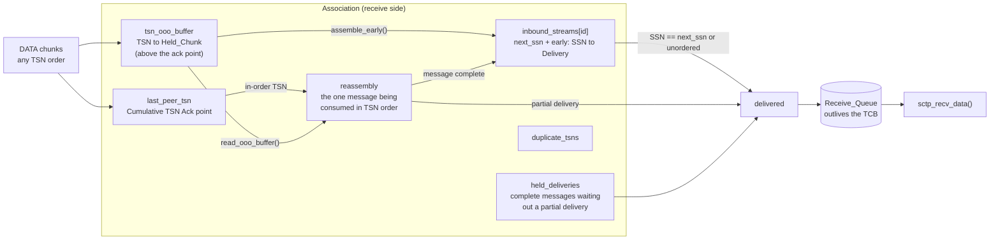

| Structure | Holds | Emptied by |
|---|---|---|
| `last_peer_tsn` | highest TSN with no gaps below it | advanced in place |
| `tsn_ooo_buffer` | chunks above `last_peer_tsn`. An entry whose message was taken out early stays with `assembled = true` and no bytes, so the SACK keeps reporting it. | `read_ooo_buffer()` once the gap fills |
| `reassembly` | the message currently open in TSN order (`open`, `partially_delivered`, stream, SSN, PPID, bytes) | completing the message |
| `inbound_streams[id]` | `next_ssn` and `early`: complete ordered messages ahead of `next_ssn` | `advance_stream()` |
| `held_deliveries` | messages completed while a different message is in partial delivery | the end of that partial delivery |
| `Receive_Queue` | delivered bytes the ULP has not read | `sctp_recv_data*` |

### Per-chunk processing

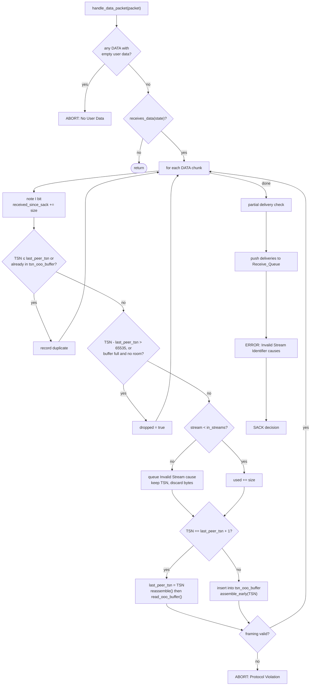

An invalid stream is still acknowledged, because its TSN advances
`last_peer_tsn`, but it is reported and never delivered.
`reassemble(..., keep_bytes = false)` still checks its framing.

### Receive buffer and drop policy

The receive buffer is a fixed `RWND` (65535) bytes of user data per
association. Occupancy is:

```
used = Receive_Queue::buffered_bytes(key)          delivered, unread
     + reassembly.bytes                            open message
     + Σ tsn_ooo_buffer user_data                  held for reordering
     + Σ inbound_streams[*].early bytes            complete, out of SSN order
     + Σ held_deliveries bytes                     waiting out a partial delivery
```

When a new chunk arrives with `used ≥ RWND`:

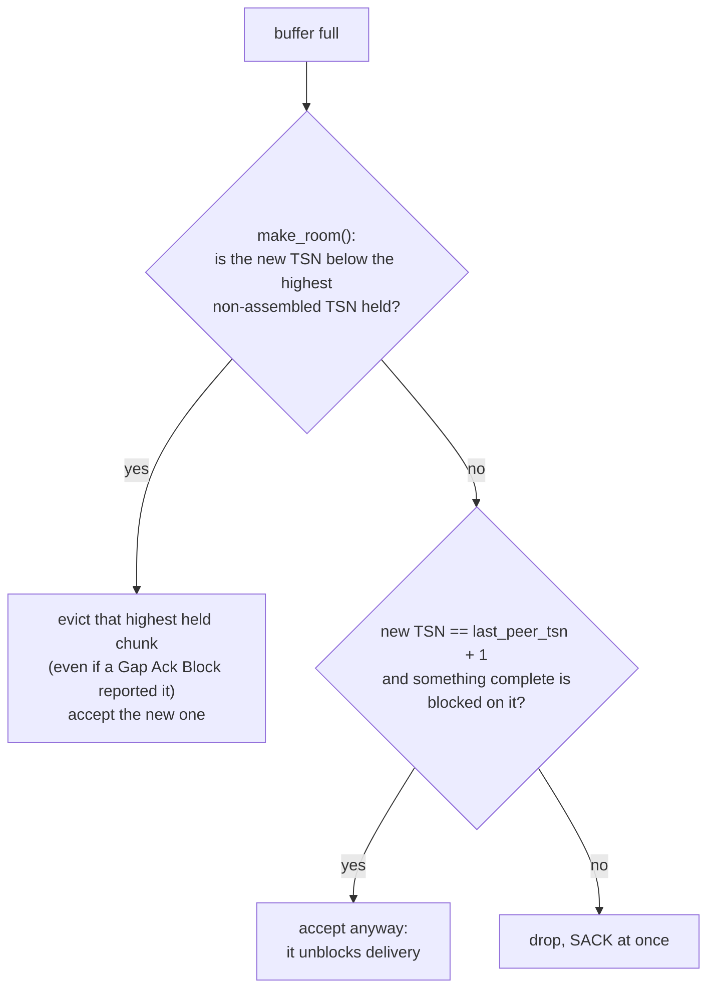

Evicting a chunk that was already gap-acked is reneging. The sender handles
this case: see [Outbound: reneging](05-outbound.md#outstanding-data-lifecycle).

### Reassembly and ordering

Two stages: **framing** in TSN order (B/E bits), then **ordering** by SSN within
a stream.

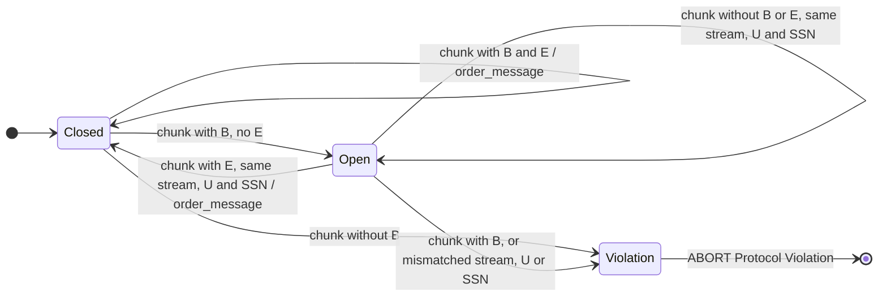

`order_message(stream, ssn, unordered, bytes)`:

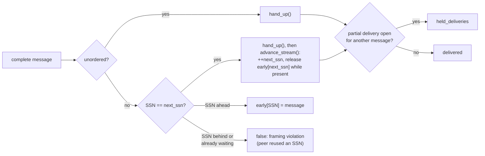

SSN comparison uses `ssn_gt`, 16-bit serial arithmetic.

### Early assembly: a gap blocks only its own stream

If only TSN-order reassembly were used, a single missing TSN would hold back
every stream. `assemble_early(tsn)` runs each time a chunk is stored above the
ack point. It walks backwards from the new chunk to a B and forwards to an E,
through **contiguous** held TSNs of the same stream, U flag and SSN:

```
 last_peer_tsn = 99           tsn_ooo_buffer
                    ┌─────┬─────┬─────┬─────┐
      (100 missing) │ 101 │ 102 │ 103 │ 104 │
                    │ s0  │ s1  │ s1  │ s1  │
                    │ B E │ B   │     │   E │  ← 104 arrives
                    └─────┴─────┴─────┴─────┘
                           ◄─── walk back to B
                           ───────────────► walk forward to E
                     102..104 form one complete message on stream 1:
                     bytes moved out, entries marked assembled
                     (they stay so the SACK still reports them)
```

The assembled message goes to `order_message()`. If stream 1 was waiting for
exactly this SSN, it is delivered even though TSN 100 is still missing. When
100 finally arrives, `read_ooo_buffer()` walks the assembled entries with
`keep_bytes = false`: their framing is still checked, but their bytes have
already been delivered.

### Partial delivery

A message larger than what the buffer can hold would deadlock: its end
cannot arrive until the ULP reads, and the ULP cannot read until it is
complete. After each packet, `handle_data_packet` checks:

```
reassembly.open  and  reassembly.bytes non-empty
and  used + AMDCS > RWND                       (no room for another full chunk)
and  (unordered  or  reassembly.ssn == inbound_streams[stream].next_ssn)
```

If this holds, the bytes collected so far are delivered with `complete =
false`, `partially_delivered` is set, and (for ordered) the stream advances.
From then on:

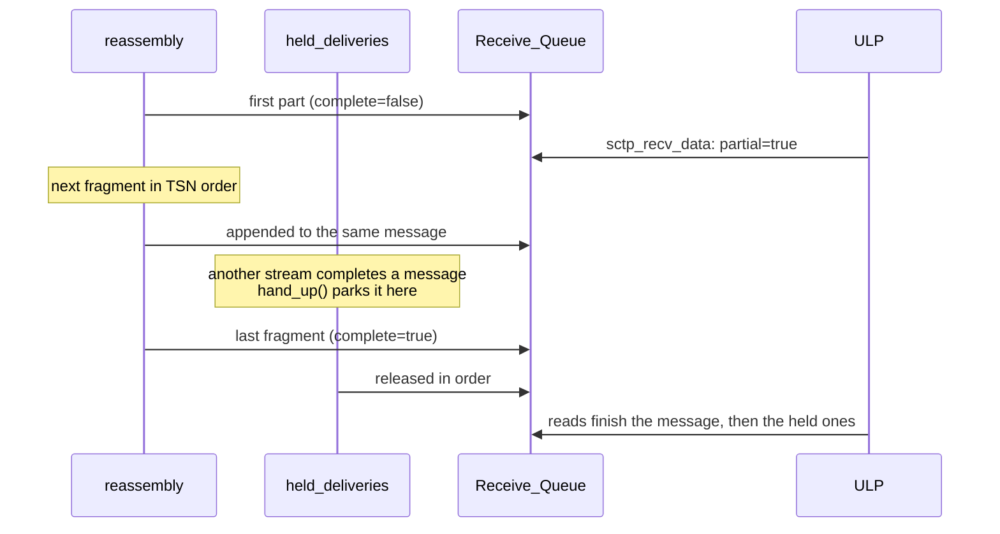

`Receive_Queue::push()` appends to the tail message while it is incomplete, so
the ULP sees one message read across several calls, each reporting
`partial = true` until the last. If the association goes away mid-message,
`abandon_partial_delivery()` drops the incomplete tail
(`Receive_Queue::abandon_open`).

### Worked example

`last_peer_tsn = 99`. Stream 0 expects SSN 0, and stream 1 expects SSN 0.

| Arrives | Chunk | What happens | Delivered | SACK |
|---|---|---|---|---|
| 1 | TSN 101, s0 SSN 1, B E | held. `assemble_early`: complete, so `early[1]` on s0 | | immediate: cum 99, gap 2-2 |
| 2 | TSN 102, s1 SSN 0, B | held, no E yet | | immediate: cum 99, gap 2-3 |
| 3 | TSN 103, s1 SSN 0, E | held. `assemble_early`: 102 to 103 complete, s1 SSN 0 == next | **s1 #0** | immediate: cum 99, gap 2-4 |
| 4 | TSN 100, s0 SSN 0, B E | in order: delivers s0 #0, `advance_stream` releases `early[1]`. `read_ooo_buffer` consumes 101 to 103 (already assembled) | **s0 #0, s0 #1** | immediate (a hole existed): cum 103 |

Stream 1 was delivered at step 3, before the gap at TSN 100 filled.

---

## Acknowledging: when to SACK

After the chunks are processed, one decision is made for the whole packet:

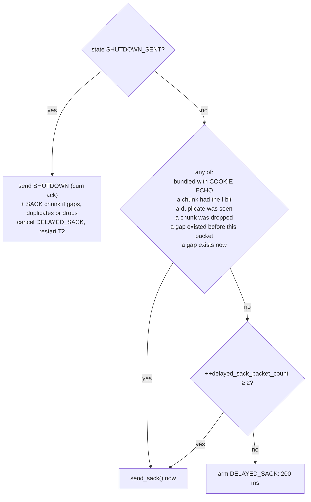

A delayed SACK is also sent early when outgoing DATA has room for it:
`prepare_data_packet()` bundles it and cancels the timer. See
[Outbound](05-outbound.md#preparing-a-data-packet).

---

## Building a SACK

`make_sack()` walks `tsn_ooo_buffer` in TSN order and merges consecutive TSNs
into blocks. Offsets are relative to `last_peer_tsn`.

```
last_peer_tsn = 1000
held TSNs:     1002 1003 1004       1007       1009 1010
offsets:          2    3    4          7          9   10
Gap Ack Blocks: [2-4]              [7-7]      [9-10]
```

The SACK carries:

| Field | Value |
|---|---|
| Cumulative TSN Ack | `last_peer_tsn` |
| a_rwnd | the [advertised window](#the-advertised-window) |
| Gap Ack Blocks | as above |
| Duplicate TSNs | `duplicate_tsns`, moved out and cleared |

It also resets `delayed_sack_packet_count`, and sets `our_rwnd` and
`received_since_sack = 0`. `send_sack()` cancels the delayed-SACK timer and
sends to `data_path()`.

---

## The advertised window

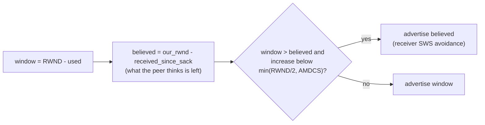

- **A shrinking window is always advertised as it is.** Only small *increases*
  are held back.
- **Window updates**: after every ULP read, `maybe_send_window_update()` sends
  a SACK if `receive_window ≥ believed + RWND/4`, so a peer stalled on a closed
  window learns that it has opened.

---

## HEARTBEAT

`handle_heartbeat` echoes the Heartbeat Info back unchanged in a HEARTBEAT ACK,
sent to the source address of the HEARTBEAT. It does not answer in
`SHUTDOWN_SENT` / `SHUTDOWN_ACK_SENT`, or when the Info is too large to echo
within the AMDCS (the peer picks the Info's length). HEARTBEAT ACK handling is
covered in [Paths](07-paths.md#heartbeats).
