# 5. Outbound path and congestion control

Sources: `src/socket/event_loop.cpp` (send pass, `cut_new_data`,
`prepare_data_packet`), `src/queues/send_queue.cpp`, `src/socket/handlers.cpp`
(`handle_sack`, `grow_cwnd`), `src/socket/timers.cpp` (`record_data_sent`,
`handle_t3_expiration`, `schedule_pending_retransmission`, `update_rto`),
`src/socket/internal.hpp` (`cwnd_open`, `bytes_in_flight`, `initial_cwnd`).

- [A message's journey](#a-messages-journey)
- [The outbound message queue](#the-outbound-message-queue)
- [Late TSN assignment](#late-tsn-assignment)
- [The send queue: three tiers](#the-send-queue-three-tiers)
- [Send allowances](#send-allowances)
- [Cutting DATA: bundling and fragmentation](#cutting-data-bundling-and-fragmentation)
- [Preparing a DATA packet](#preparing-a-data-packet)
- [After the packet leaves](#after-the-packet-leaves)
- [Outstanding data lifecycle](#outstanding-data-lifecycle)
- [Processing a SACK](#processing-a-sack)
- [Congestion control](#congestion-control)
- [Fast retransmit and fast recovery](#fast-retransmit-and-fast-recovery)
- [T3-rtx expiry](#t3-rtx-expiry)
- [Building retransmissions](#building-retransmissions)
- [Flow control and zero window probing](#flow-control-and-zero-window-probing)
- [RTT measurement](#rtt-measurement)

---

## A message's journey

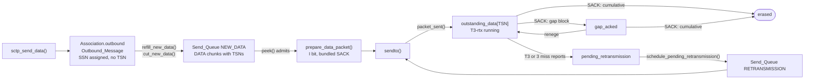

---

## The outbound message queue

`sctp_send_data()` does very little:

1. Checks the state (`ESTABLISHED` only), that the message is not empty, the
   stream ID, and the send buffer.
2. Assigns `ssn = next_ssn[stream]++`, but only for ordered messages. An
   unordered message gets SSN 0.
3. Appends `Outbound_Message{stream, ssn, unordered, bytes, offset 0, ppid}` to
   `assoc.outbound`, and adds its size to `outbound_bytes`.
4. Wakes the loop.

**Send buffer.** `SEND_BUFFER` is 256 KiB of *unsent* bytes per association.
A message is refused with `QUEUE_FULL` if accepting it would exceed the buffer,
**except** when nothing is queued: a message of any size is always accepted
into an empty queue.

---

## Late TSN assignment

TSNs are assigned by `cut_new_data()`, during the send pass, only when a packet
can actually leave. This has three consequences:

- A packet is cut to fit the windows **as they are at that moment**, not as
  they were when the ULP called `send`.
- The send queue holds at most **one** new-DATA packet per association
  (`refill_new_data` skips associations for which `has_new_data_for()` is
  true). TSNs therefore reach the wire in the order they were assigned.
- `next_tsn - 1` is the highest TSN ever cut, which may be queued but not yet
  sent. That is why the shutdown check compares against `next_tsn` rather than
  `outstanding_data`.

---

## The send queue: three tiers

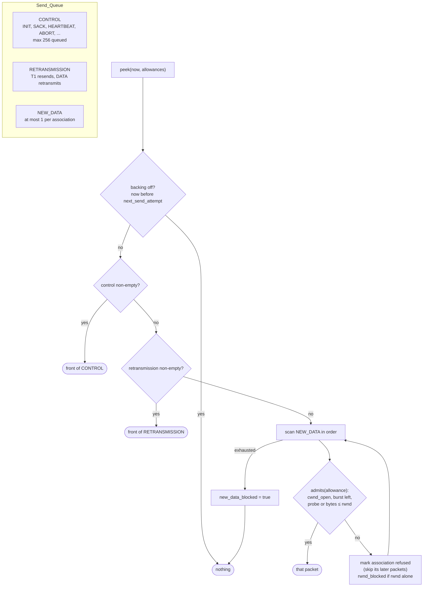

- **Strict priority.** Control traffic always goes first, then
  retransmissions, then new DATA.
- **Per-association gating.** An association with a closed window does not
  hold back another association's new DATA.
- **Order within an association.** Once an association is refused, its later
  packets are skipped in this pass.
- **Retransmissions are not gated in `peek()`.** They are gated when they are
  *built* (see [Building retransmissions](#building-retransmissions)).
- **`new_data_blocked`** tells `next_deadline()` not to spin on new DATA that
  was just refused. It is cleared by the next `enqueue()`.

Housekeeping methods used by handlers:

| Method | Used when |
|---|---|
| `purge(key)` | association removed or restarted |
| `remove_acked_retransmissions(key, sack)` | after every SACK and SHUTDOWN: drops queued retransmitted DATA that is now acked |
| `remove_retransmissions_of_type(key, type, dest?)` | handshake finished (drop queued INIT / COOKIE ECHO, and any ERROR bundled behind it), or T3 moved chunks off a failed destination |

---

## Send allowances

`send_allowances()` builds a snapshot per association, under the lock, before
each `peek()`:

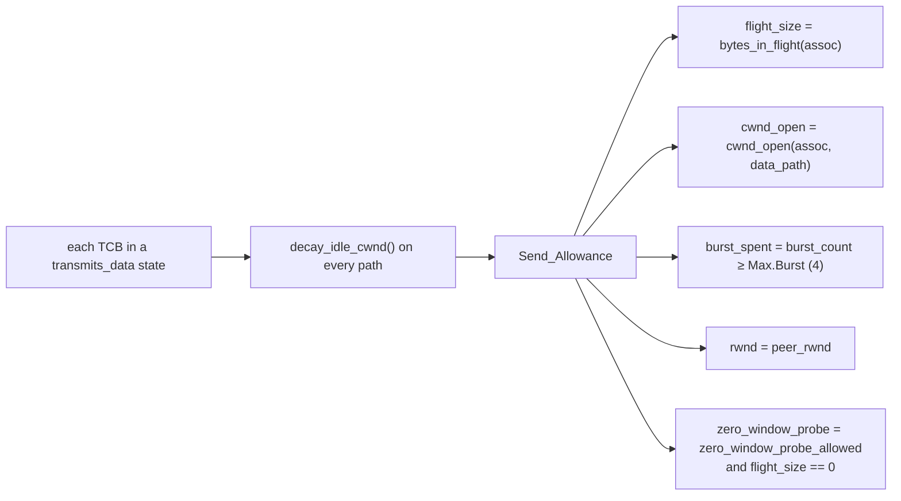

```
bytes_in_flight(assoc, path?) = Σ wire size of outstanding chunks
                                 not gap_acked, not pending_retransmission
                                 (on that path, if given)

cwnd_open(assoc, path) = single_packet_in_flight ? flight(path) == 0
                                                 : flight(path) < path.cwnd
```

`next_packet()` then runs:

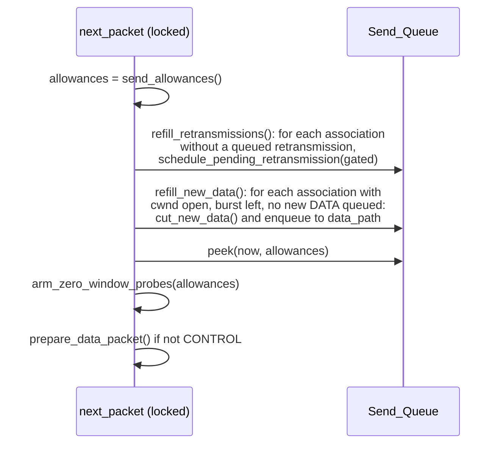

### Max.Burst

`burst_count` is reset for every association at the start of each
`run_sending()` (`start_transmission_opportunity`), and incremented in
`packet_sent()` for each NEW_DATA packet. When it reaches `MAX_BURST` (4),
that association sends no more new DATA until the next pass. Retransmissions
and control packets are not counted.

---

## Cutting DATA: bundling and fragmentation

`cut_new_data(assoc, allowance)` builds **one** packet from the head of
`outbound`:

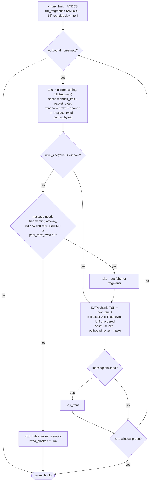

The rules this encodes:

- **Bundling (§6.10).** Several messages share one packet while they fit
  within the AMDCS and the peer's window.
- **Fragment only when necessary (§6.9).** A message is fragmented only if
  it cannot fit in a packet of its own (`size > full_fragment`). A message that
  would fit in an empty packet is never split just to fill a partly used one.
- **Sender SWS avoidance (§6.1).** A fragment is cut short to fit the window
  only if the shorter piece is still at least half the largest window the peer
  has ever offered. Otherwise the sender waits.
- **AMDCS, not PMDCS.** Chunks are cut to the smallest PMDCS across usable
  paths, so a chunk retransmitted to an alternate destination still fits. See
  [PMTU](08-pmtu.md#size-terms).

Example with AMDCS = 1180, so `full_fragment` = 1164:

```
outbound: [A: 300 B] [B: 500 B] [C: 3000 B]

packet 1:  DATA A (B E, 316 B)  DATA B (B E, 516 B)
           C stays out: the 348 B left would only take a fragment far below peer_max_rwnd / 2
packet 2:  DATA C[0..1164)    (B,   1180 B)
packet 3:  DATA C[1164..2328) (     1180 B)
packet 4:  DATA C[2328..3000) (  E,  688 B)
```

---

## Preparing a DATA packet

`prepare_data_packet(deliverable, new_data)` runs on the `peek()`ed copy,
just before it is sent:

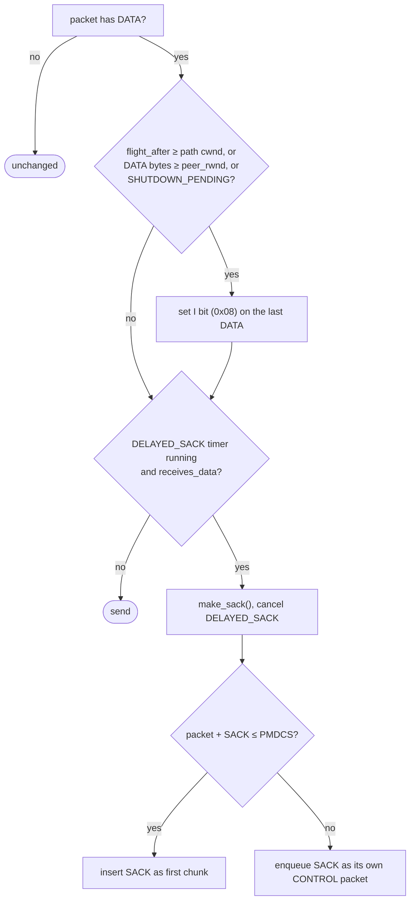

The I bit asks the peer to SACK immediately. It is set when the packet fills
the window, so the SACK that reopens the window is not delayed, and during a
shutdown, so the SACK that lets the shutdown complete is not delayed.

---

## After the packet leaves

`packet_sent()` calls `schedule_expirations_after_send()`, which walks the
chunks:

| Chunk | Bookkeeping |
|---|---|
| DATA, new TSN | `outstanding_data[tsn]` created (first and last sent, destination). `peer_rwnd -= size`. `new_data_sent_at` and `data_sent_at` updated (heartbeat idleness, cwnd decay). Becomes the RTT measurement TSN if none is pending. The zero window probe flags update. |
| DATA, retransmitted | `retransmitted = true`, `gap_acked = false`, `last_sent`, destination updated. `peer_rwnd -= size`. Any RTT measurement at or above this TSN is abandoned (Karn). |
| HEARTBEAT | `hb_sent_at` is set to the real send time, so RTT excludes time spent queued. |
| INIT / COOKIE ECHO | T1 armed with the packet stored for retry. |
| any DATA in the packet | T3-rtx for that destination started if it is not already running. |

---

## Outstanding data lifecycle

Each `Outstanding_Data` entry tracks one sent DATA chunk:

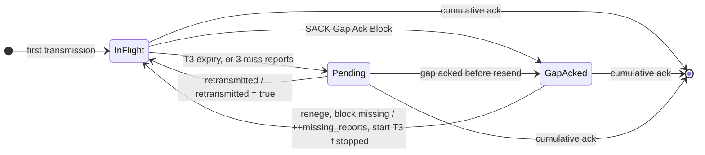

| Flag | Meaning |
|---|---|
| `gap_acked` | covered by a Gap Ack Block in the latest SACK. Not in flight. |
| `pending_retransmission` | marked for resend. Not in flight. `destination` is where it will go next. |
| `retransmitted` | sent more than once: excluded from RTT measurement, and remembered in `acked_retransmissions` for duplicate-TSN accounting |
| `fast_retransmitted` | already fast-retransmitted once. Not again (§7.2.4). |
| `missing_reports` | miss indications. Three trigger a fast retransmit. |

---

## Processing a SACK

`handle_sack()`:

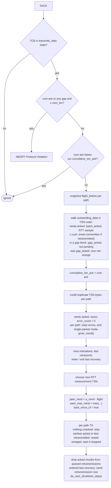

Everything is computed **per destination**. `Path_Ack` collects, for each
path, the flight before the SACK, the bytes newly acked, duplicate bytes,
the earliest outstanding TSN, and whether chunks there were reneged or
fast-retransmitted. A SACK can therefore grow one path's cwnd while another
path enters fast recovery.

---

## Congestion control

All congestion state lives on `Peer_Path`. Sizes are in bytes, and PMDCS is the
path's current PMDCS.

| Event | Effect |
|---|---|
| Path created | `cwnd = min(4·PMDCS, max(2·PMDCS, 4404))`, which is 4404 at BASE_PMDCS 1180. `ssthresh = 65535`. |
| SACK, slow start (`cwnd ≤ ssthresh`) | if the window was full before this SACK and not in fast recovery: `cwnd += min(bytes_acked, PMDCS)` |
| SACK, congestion avoidance | `partial_bytes_acked += bytes_acked + duplicate_bytes`. If `pba ≥ cwnd` and the window was full: `pba -= cwnd`, `cwnd += PMDCS`. Else `pba` is capped at `cwnd`. |
| Nothing outstanding on the path after a SACK | `partial_bytes_acked = 0` |
| Fast retransmit, on entering fast recovery | `ssthresh = max(cwnd/2, 4·PMDCS)`, `cwnd = ssthresh`, `pba = 0` on each path with a fast-retransmitted chunk |
| T3-rtx expiry (not zero window probing) | `ssthresh = max(cwnd/2, 4·PMDCS)`, `cwnd = PMDCS`, `pba = 0`, `single_packet_in_flight = true` |
| First SACK newly acking data on that path | `single_packet_in_flight = false` |
| Idle for an RTO or more | on the first idle period `ssthresh = cwnd`, then `cwnd` halves per RTO, never below `4·PMDCS` and never raised |

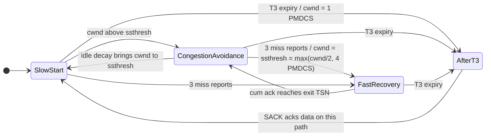

`FastRecovery` is per association (`in_fast_recovery`,
`fast_recovery_exit_tsn`), but the cwnd changes apply only to the paths whose
chunks were fast-retransmitted. While in fast recovery, slow start does not
grow cwnd.

### Duplicate TSN accounting

A Duplicate TSN in a SACK means a retransmission was not needed but still used
the network. `duplicate_bytes()` finds the size and destination of each
reported duplicate: in `outstanding_data`, or in `acked_retransmissions` (a
64-entry memory of retransmitted chunks already acked cumulatively). It credits
those bytes to the path's `partial_bytes_acked` in congestion avoidance. Each
remembered entry is consumed once, so a repeated report is not counted twice.

---

## Fast retransmit and fast recovery

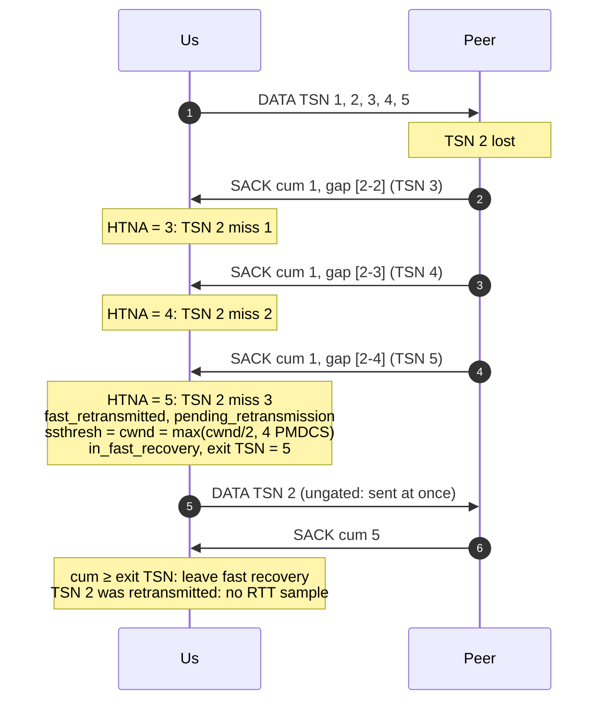

A miss indication is counted for each outstanding, not gap-acked, not yet
fast-retransmitted TSN that lies **below** the highest TSN newly acknowledged
by this SACK (HTNA). In fast recovery, when the cumulative ack advances, the
reference is instead the highest TSN this SACK reports at all. A chunk just
detected as reneged has already had its count raised once, so it is not
counted again.

Only **entering** fast recovery sends a retransmission immediately. Chunks
marked later go out through `refill_retransmissions`, gated by cwnd.

---

## T3-rtx expiry

One T3-rtx timer per destination (`Expiration_Key.path`).

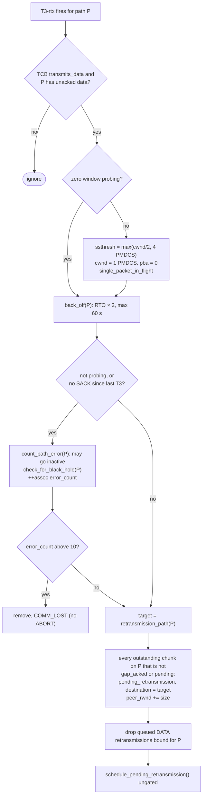

`retransmission_path()` picks an active, CONFIRMED destination other than the
failed one, the next in list order. If there is none, it keeps the original
(see [Paths](07-paths.md#choosing-a-destination)).

---

## Building retransmissions

`schedule_pending_retransmission(key, gated)` builds **one** packet:

1. Collect chunks with `pending_retransmission` and not `gap_acked`, in TSN order.
2. The destination is that of the lowest such TSN.
3. If `gated` and `cwnd_open()` is false for that destination, stop.
4. Bundle that destination's chunks, in TSN order, while the packet fits in
   `12 + PMDCS(destination)`.
5. If even the first chunk alone is larger, because the path's PMTU fell after
   the chunk was cut, send it anyway with `ip_fragment = true`. It leaves
   without DF and relies on IP fragmentation, because a DATA chunk is never
   re-fragmented (§6.9).
6. Clear `pending_retransmission` on the bundled chunks, and enqueue at
   `RETRANSMISSION` priority.

| Caller | Gated? |
|---|---|
| T3-rtx expiry | no: one packet goes regardless of cwnd |
| Entering fast recovery | no |
| `refill_retransmissions` on every send pass | yes |

---

## Flow control and zero window probing

`peer_rwnd` is our running estimate of the peer's free buffer:

```
on SACK:          peer_rwnd = a_rwnd - bytes_in_flight     (floored at 0)
on each send:     peer_rwnd -= chunk wire size
on T3 marking:    peer_rwnd += chunk wire size              (no longer in flight)
```

When the window is closed and nothing is in flight, nothing would ever arrive
to reopen it. Zero window probing (§6.1 A) handles this:

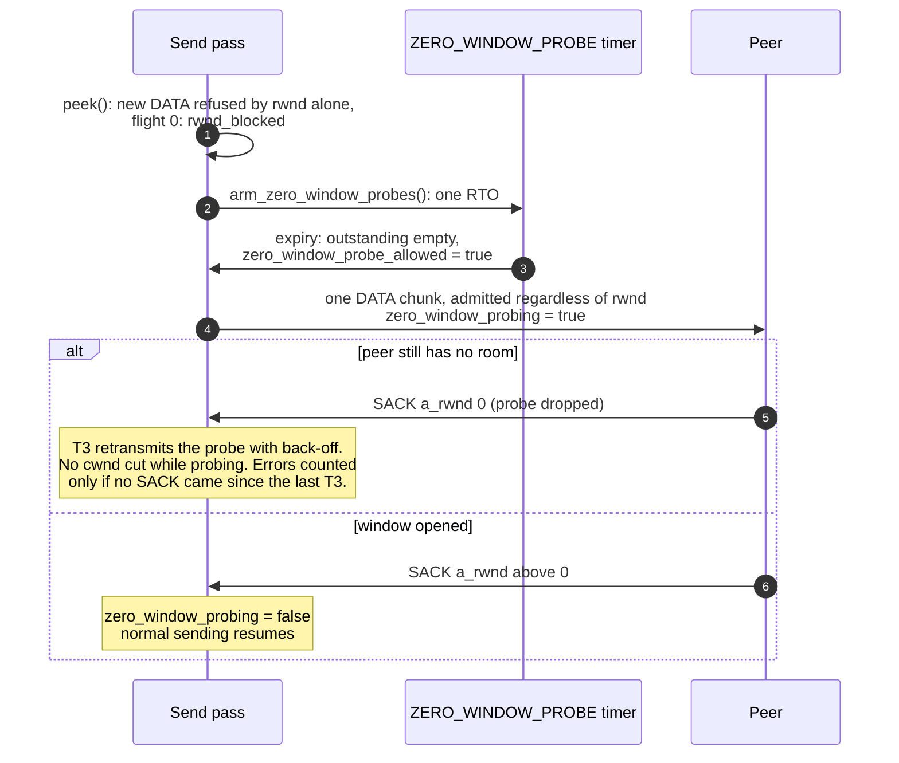

---

## RTT measurement

At most one TSN is being timed at a time (`rtt_measurement_tsn`). This follows
Karn's algorithm:

- **Start**: when a new TSN is sent and none is being timed.
- **Sample**: when the SACK newly acknowledges that TSN and it was never
  retransmitted. Feeds `update_rto()` on the path it was sent to.
- **Abandon**: when a chunk at or below it is retransmitted.
- **Re-pick** after each SACK: the lowest outstanding TSN that is not
  gap-acked and not retransmitted, and that was not first sent before a
  retransmission at or below it.

Heartbeat RTTs are sampled separately, per path. See [Timers: RTO](06-timers.md#rto-estimation).
