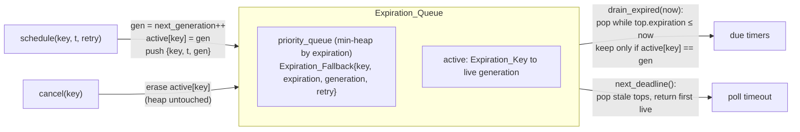
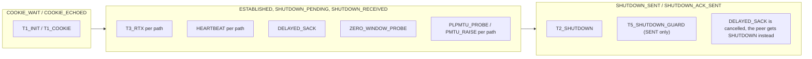
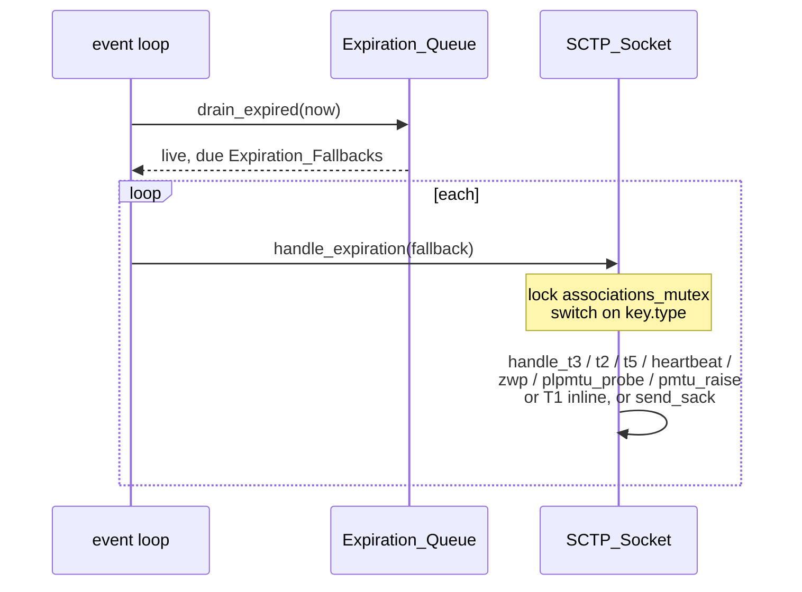
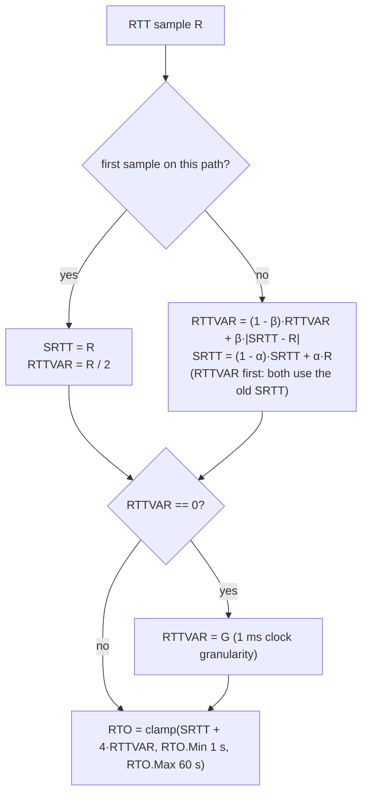
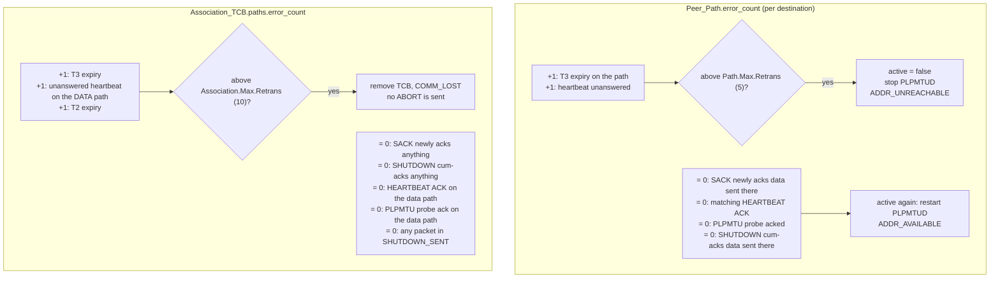

# 6. Timers

Sources: `include/sctp/queues/expiration_queue.hpp`,
`src/queues/expiration_queue.cpp`, `src/socket/timers.cpp`,
`src/socket/plpmtud.cpp`, `src/socket/event_loop.cpp`
(`schedule_expirations_after_send`, `schedule_expiration`).

- [The expiration queue](#the-expiration-queue)
- [Timer catalogue](#timer-catalogue)
- [How a timer fires](#how-a-timer-fires)
- [RTO estimation](#rto-estimation)
- [Back-off](#back-off)
- [Error counters](#error-counters)
- [Adding a timer](#adding-a-timer)

---

## The expiration queue

`std::priority_queue` cannot remove an element from the middle, so
cancellation works with **generation stamps**:



- **Re-scheduling replaces.** `schedule()` on a key that is already running
  just makes a new generation live. The older heap entry becomes stale and is
  discarded when it reaches the top.
- **Cancel is O(1) in the map.** Stale entries are popped lazily, by
  `drain_expired` and `next_deadline`.
- **`cancel_all(location)` / `cancel_all(location, type)`** erase from
  `active` by predicate: every timer of an association, or every timer of one
  type (all per-path HEARTBEAT or T3 timers at once).
- **`retry`** is a `Deliverable` carried with the timer. Only T1 uses it: the
  INIT or COOKIE ECHO to resend.

### Keys

```cpp
struct Expiration_Key {
    Association_Key location;     // which association (its id)
    Expiration_Timer_Type type;
    Peer_Key path{};              // path_key(destination) for per-path timers, else zero
};
```

`SCTP_Socket::schedule_expiration`, `cancel_expiration` and
`cancel_expirations` wrap the queue so that they also **wake the event loop**.
Its `poll()` deadline is stale as soon as the heap changes. Code that only
cancels by type calls `expirations.cancel_all(...)` directly: a cancel can
only make the deadline later, and the next pass recomputes it anyway.

---

## Timer catalogue

| Timer | Scope | Armed by | Duration | On expiry |
|---|---|---|---|---|
| `T1_INIT` | association | INIT leaving (`schedule_expirations_after_send`) | `RTO_INITIAL · 2^n`, capped at `RTO_MAX` | Resend INIT, or `CANT_STR_ASSOC` after 8 retransmits |
| `T1_COOKIE` | association | COOKIE ECHO leaving | same | Resend COOKIE ECHO, or `CANT_STR_ASSOC` |
| `T3_RTX` | **per path** | DATA leaving to a path whose T3 is stopped. Restarted by SACK rules. | path RTO | [T3 procedure](05-outbound.md#t3-rtx-expiry) |
| `DELAYED_SACK` | association | DATA received with no reason to SACK at once | `SACK_DELAY` 200 ms | `send_sack()` |
| `HEARTBEAT` | **per path** | `arm_heartbeat()` | to `hb_next`, or `hb_sent_at + RTO` while a probe is out | [heartbeat procedure](07-paths.md#heartbeats) |
| `T2_SHUTDOWN` | association | SHUTDOWN or SHUTDOWN ACK sent, or any packet in `SHUTDOWN_SENT` | data path RTO | back off, error count, resend a rebuilt SHUTDOWN / SHUTDOWN ACK |
| `T5_SHUTDOWN_GUARD` | association | entering `SHUTDOWN_SENT` (once) | `5 · RTO_MAX` = 300 s | ABORT, `COMM_LOST` |
| `ZERO_WINDOW_PROBE` | association | window closed with nothing in flight | data path RTO | allow one probe chunk |
| `PLPMTU_PROBE` | **per path** | `schedule_plpmtu_probe()` | `PROBE_TIMER` 15 s (first probe: one RTO) | send probe, or count a lost probe. See [PMTU](08-pmtu.md). |
| `PMTU_RAISE` | **per path** | search complete, or ERROR state | `PMTU_RAISE_TIMER` 600 s | search again |

### Timers by association state



`do_next_shutdown_step()` cancels every HEARTBEAT and T3 timer and the
DELAYED_SACK timer when it sends SHUTDOWN or SHUTDOWN ACK. Expiry handlers for
heartbeat, T3, and PLPMTUD also check `transmits_data(state)`, so a timer that
slips through does nothing.

---

## How a timer fires



Every handler first re-checks that the TCB and path still exist and are in the
expected state. A timer can outlive what it was for: the association may have
been replaced by a restart under the same key, or the path may have gone
inactive.

---

## RTO estimation

`update_rto(path, R)` is §6.3.1, per destination, in microseconds:



α = 1/8, β = 1/4. Samples come from:

| Source | Where |
|---|---|
| DATA newly acked, never retransmitted, and the one being timed | `handle_sack` |
| HEARTBEAT ACK matching the outstanding nonce | `handle_heartbeat_ack`: `now - hb_sent_at` |

`hb_sent_at` is stamped when the packet actually leaves (`record_heartbeat_sent`),
not when it is built, so time spent in the send queue is not counted. The
send time is deliberately kept out of the Heartbeat Info: keeping it locally
is more accurate, and it cannot be forged by the peer.

---

## Back-off

`back_off(path)`: `rto = min(rto · 2, RTO_MAX)`. It is applied on:

- T3-rtx expiry, to the expired path,
- an unanswered heartbeat, to that path,
- T2 expiry, to the data path.

The next valid RTT sample recomputes the RTO from SRTT/RTTVAR, which undoes the
back-off. T1 does not use the path RTO: it doubles from `RTO_INITIAL` by
itself, based on the retransmit count.

---

## Error counters

There are two counters, and they move independently:



- **An inactive path stops counting.** `count_path_error` only increments
  while `active`.
- **Only the data path's heartbeats affect the association counter** (§8.1).
  Otherwise an idle alternate that still answers heartbeats would keep alive an
  association whose data path has failed.
- **While zero window probing,** T3 expiries count errors only if no SACK
  arrived since the previous T3. A peer that keeps answering with a zero
  window is alive.

---

## Adding a timer

1. Add the type to `Expiration_Timer_Type`.
2. Decide its scope. If it is per destination, fill `Expiration_Key.path` with
   `path_key(address)`, as `T3_RTX` and `HEARTBEAT` do.
3. Arm it with `schedule_expiration()`, which also wakes the loop. Never call
   `expirations.schedule()` directly from `SCTP_Socket`.
4. Add a case to the `switch` in `handle_expiration()`. The compiler warns
   when a case is missing.
5. In the handler, first re-check that the TCB exists, that the state is right,
   and that the path exists.
6. Cancel it wherever its reason goes away. `remove_association` already
   cancels everything for the association.
7. Tests: the RFC harness can fire a timer directly with
   `SCTP_Socket_Test_Access::fire(socket, type, ip)`, without waiting. See
   [Testing](11-testing.md#the-in-process-harness).
