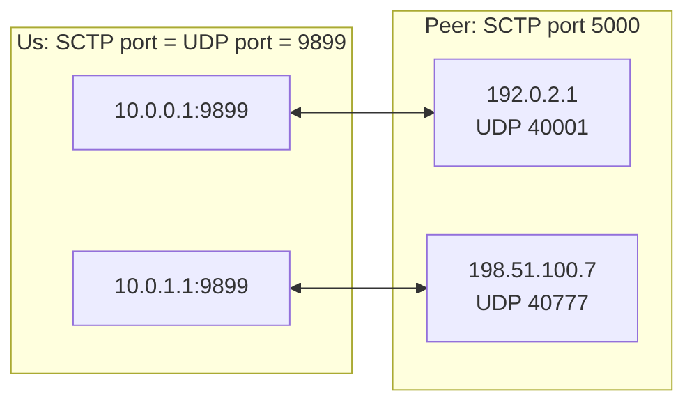
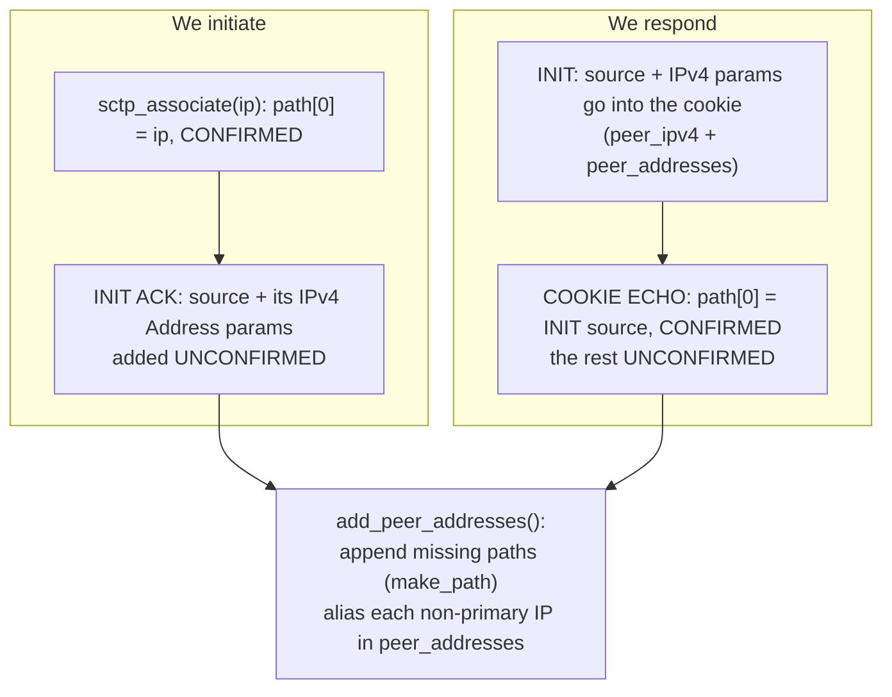
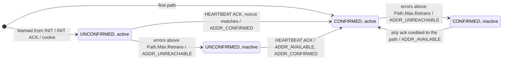
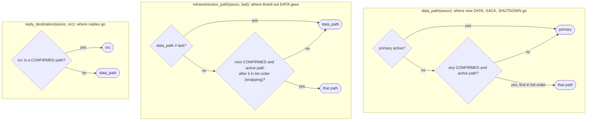
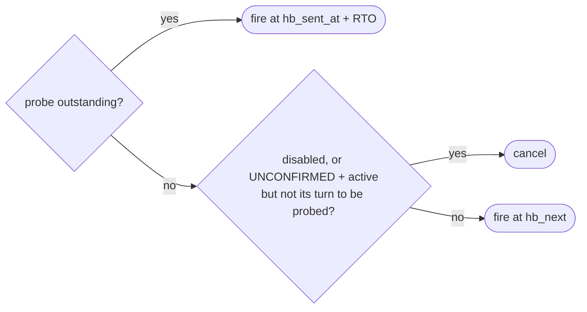
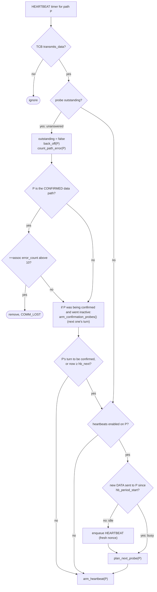
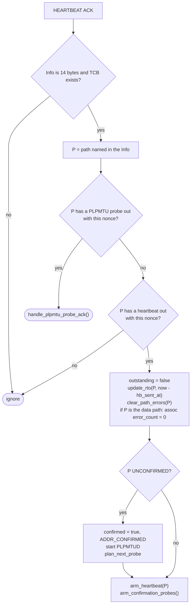
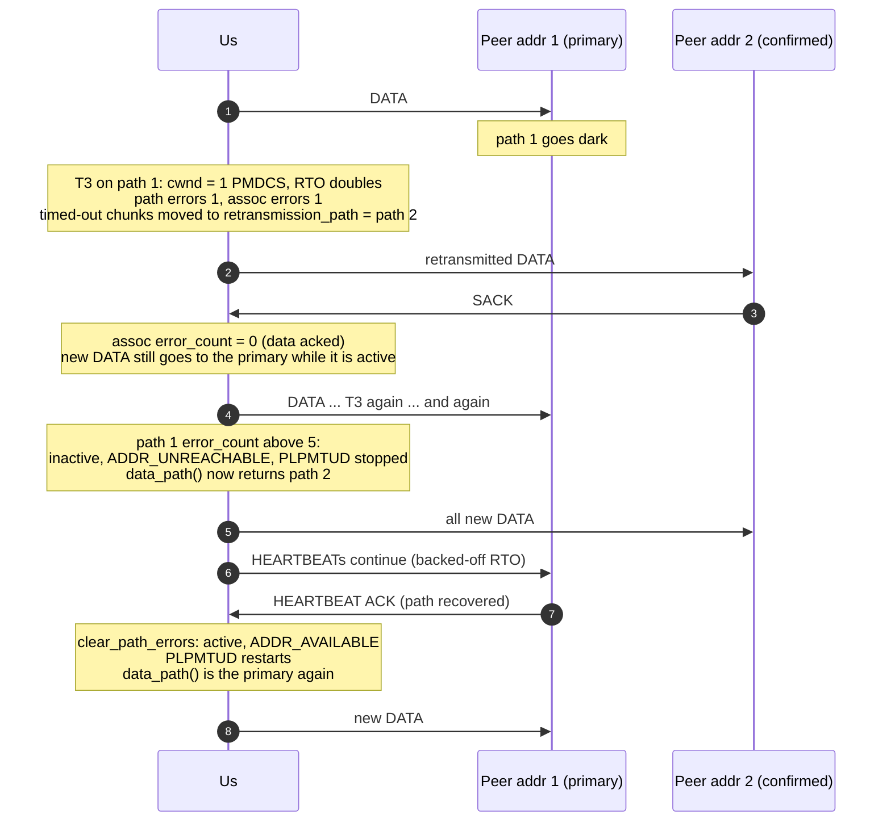
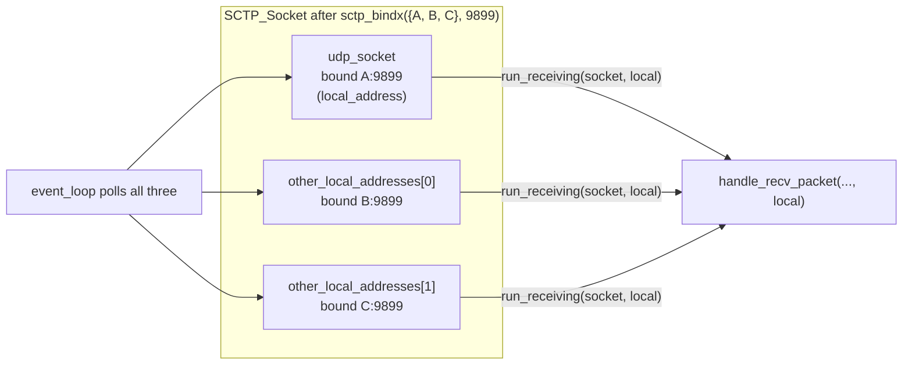
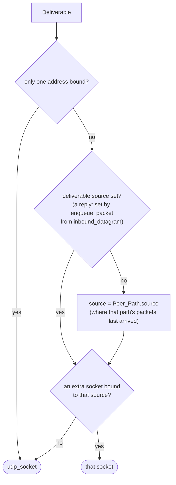

# 7. Paths, multi-homing and encapsulation

Sources: `src/socket/internal.hpp` (path selection helpers),
`src/socket/api.cpp` (`add_peer_addresses`, `record_arrival`, `sctp_bindx`,
heartbeat and primary controls), `src/socket/timers.cpp` (heartbeats, error
counting), `src/socket/handlers.cpp` (`handle_heartbeat_ack`,
`transport_addresses`), `src/socket/event_loop.cpp` (`sending_socket`).

- [Addresses, ports and keys](#addresses-ports-and-keys)
- [Learning the peer's addresses](#learning-the-peers-addresses)
- [Path states](#path-states)
- [Choosing a destination](#choosing-a-destination)
- [Heartbeats](#heartbeats)
- [Failover, end to end](#failover-end-to-end)
- [ULP controls](#ulp-controls)
- [Multiple local addresses](#multiple-local-addresses)
- [UDP encapsulation ports](#udp-encapsulation-ports)

---

## Addresses, ports and keys

A multi-homed peer reached over UDP encapsulation. The peer has one SCTP port,
and each of its addresses may send from a different UDP port (NATs, for
example):



How that peer is represented:

```
associations        key = {192.0.2.1, SCTP 5000}           ← primary address + SCTP port
peer_addresses      {198.51.100.7, SCTP 5000} → {192.0.2.1, SCTP 5000}

Association.peer_address_list
  [0] Peer_Path{ address = 192.0.2.1:40001    confirmed, source = 10.0.0.1 }
  [1] Peer_Path{ address = 198.51.100.7:40777 confirmed, source = 10.0.1.1 }
                         └── sin_port is the UDP port, not the SCTP port

per-path timers     Expiration_Key{ location = key, type, path = {198.51.100.7, port 0} }
```

Two `sockaddr_in` values are the same destination when their IPs match
(`same_destination`). Ports are never compared at the path level.

---

## Learning the peer's addresses



`transport_addresses(src, params)` always puts the packet's source first, then
each IPv4 Address parameter once. Every new path starts with the **source's**
UDP port, until that address sends a packet itself. Host Name Address
parameters are refused with an ABORT (*Unresolvable Address*). IPv6 is not
implemented.

The first path is CONFIRMED because we have a reason to trust it: either the
ULP asked us to connect to it, or it is where the INIT came from and the cookie
came back through it. Every other address must be confirmed by heartbeat
before DATA can go there (§5.4).

---

## Path states

Each `Peer_Path` has two independent booleans:



| | DATA | Heartbeats | `sctp_set_primary` | Counts toward AMDCS | PLPMTUD |
|---|:-:|:-:|:-:|:-:|:-:|
| UNCONFIRMED | never | confirmation probes, every RTO | refused | no | off |
| CONFIRMED, active | ✔ | every HB.interval + RTO ± jitter, when idle | ✔ | ✔ | running |
| CONFIRMED, inactive | only if no active path exists | keep probing | ✔ | no | stopped |

---

## Choosing a destination

All helpers are in `internal.hpp`:



`primary(assoc)` is the path matching `primary_path`. If it is missing, the
first path in the list is used. `amdcs(assoc)` is the smallest PMDCS over
CONFIRMED, active paths (`BASE_PMDCS` if there are none). New DATA is cut to
this size so it fits whichever path a retransmission ends up on.

---

## Heartbeats

### Scheduling

`plan_next_probe(assoc, path, now)` sets the next probe time:

```
hb_period_start = now
CONFIRMED path:            hb_next = now + HB.interval + RTO + U(-RTO/2, +RTO/2)
path being confirmed:      hb_next = now + RTO
```

`arm_heartbeat()` then sets the path's HEARTBEAT timer:



**Confirmation in turns.** `probes_for_confirmation()` lets only
`HB_MAX_BURST` (1) UNCONFIRMED, active, enabled path be probed at a time, in
list order. When that path confirms or fails, `arm_confirmation_probes()`
starts the next one at once.

### When the HEARTBEAT timer fires



A path that carried new DATA during the period is already proving itself
through SACKs, so it is not probed (§8.3).

### The Heartbeat Info

The HEARTBEAT chunk carries a 14-byte Heartbeat Info that only we interpret:

```
 0                   1                   2                   3
 0 1 2 3 4 5 6 7 8 9 0 1 2 3 4 5 6 7 8 9 0 1 2 3 4 5 6 7 8 9 0 1
+-+-+-+-+-+-+-+-+-+-+-+-+-+-+-+-+-+-+-+-+-+-+-+-+-+-+-+-+-+-+-+-+
|                     nonce, high 32 bits                       |
+-+-+-+-+-+-+-+-+-+-+-+-+-+-+-+-+-+-+-+-+-+-+-+-+-+-+-+-+-+-+-+-+
|                     nonce, low 32 bits                        |
+-+-+-+-+-+-+-+-+-+-+-+-+-+-+-+-+-+-+-+-+-+-+-+-+-+-+-+-+-+-+-+-+
|               destination IPv4 address (as in sin_addr)       |
+-+-+-+-+-+-+-+-+-+-+-+-+-+-+-+-+-+-+-+-+-+-+-+-+-+-+-+-+-+-+-+-+
|  destination UDP port (as in  |
|  sin_port)                    |
+-+-+-+-+-+-+-+-+-+-+-+-+-+-+-+-+
```

- The **nonce** is random per probe (`build_probe`). It tells this ACK apart
  from one answering an older probe, which would otherwise clear a failing
  path's error count.
- The **destination** says which path the ACK is for. It may arrive on a
  different path (§5.4 / §8.3).
- There is **no timestamp**. The send time is recorded on the path when the
  packet leaves (`record_heartbeat_sent`), which is more accurate and cannot be
  forged.

### HEARTBEAT ACK



---

## Failover, end to end



---

## ULP controls

| Call | Effect |
|---|---|
| `sctp_change_heartbeat(key, dest, enabled, interval?)` | Sets `hb_enabled` on that path. A new `interval` replaces `hb_interval` for **every** path. Each affected path without a probe out is re-planned (probed at once if it is its turn for confirmation) and re-armed, then the confirmation turns are re-armed. In forming or closing states the settings are stored but no timers are armed. |
| `sctp_request_heartbeat(key, dest)` | Sends a HEARTBEAT to that path now (fresh nonce) and arms its timer for the answer. Only in `transmits_data` states. |
| `sctp_set_primary(key, dest)` | Sets `primary_path`. Refused (`UNCONFIRMED_DESTINATION`) for a path that is not CONFIRMED. |

Destinations are matched by IP only, so the port in the `sockaddr_in` the ULP
passes does not matter.

---

## Multiple local addresses



- **Advertised.** When more than one address is bound,
  `advertised_addresses()` lists all of them as IPv4 Address parameters in
  INIT and INIT ACK. With one address it returns an empty list, so the peer
  uses the packet's source.
- **Same port.** Extra addresses are bound at the first socket's port, even
  when port 0 asked for an ephemeral one (§1.3: one port per endpoint).
- **Wildcard.** `0.0.0.0` must be bound alone.

### Which socket sends



`Peer_Path.source` is set by `record_arrival()` for every packet that passes the
tag check, except one led by an INIT.

---

## UDP encapsulation ports

RFC 6951 puts SCTP inside UDP. The UDP port and the SCTP port are separate:

| | SCTP port | UDP port |
|---|---|---|
| Ours | `local_address.sin_port`. Our SCTP port **is** our UDP port. | same |
| Peer | in `Association_Key`, fixed for the association | per path in `Peer_Path.address.sin_port`, learned |

- `sctp_associate(ip, port, out, udp_port)`: `port` is the peer's SCTP port.
  `udp_port` (default: the same as `port`) is where to send the INIT.
- A path's UDP port is updated by `record_arrival()` from the source port of
  each packet that **passed the Verification Tag check**. An attacker therefore
  cannot redirect a path with a forged packet.
- The State Cookie records the UDP port the INIT came from
  (`peer_udp_port`), so the responder's first path starts with the right one.
- Notifications report a peer address with the **SCTP** port
  (`notify_peer_addr_change` swaps it in), not the UDP port.
