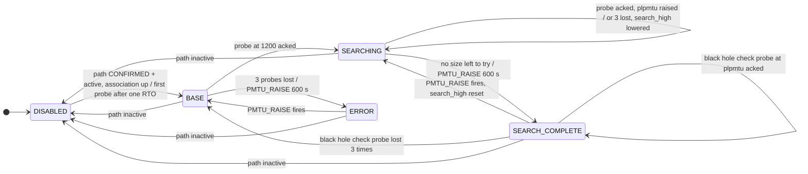
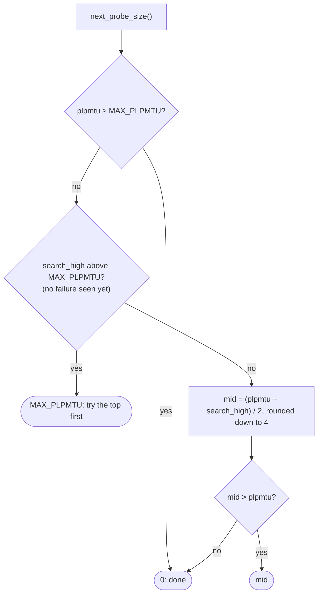
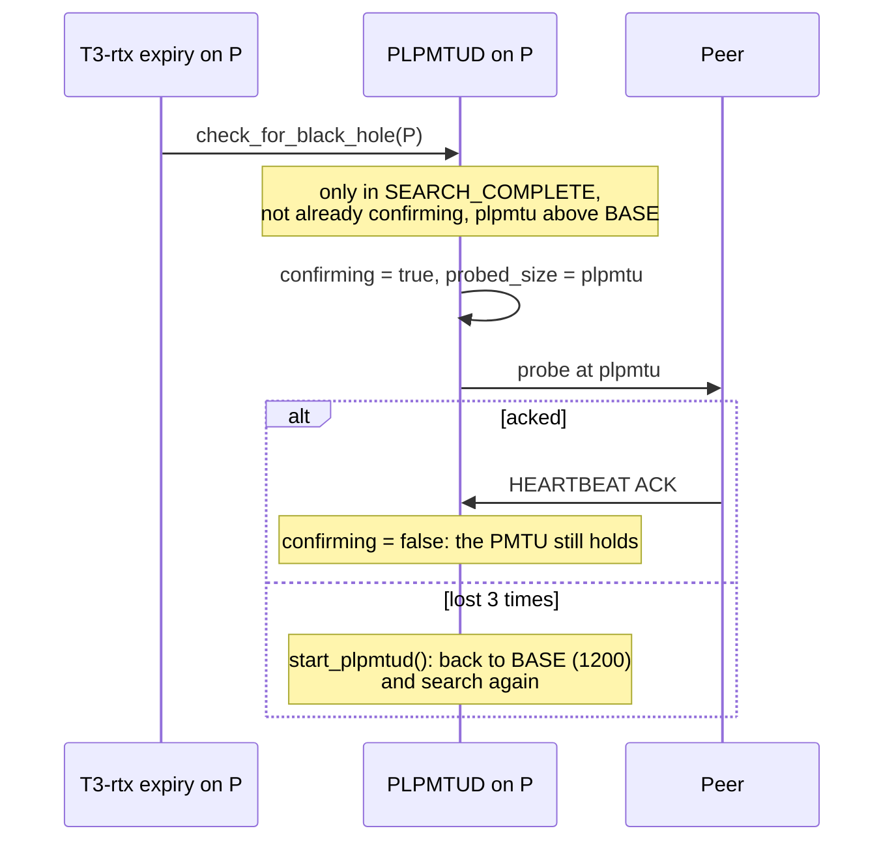
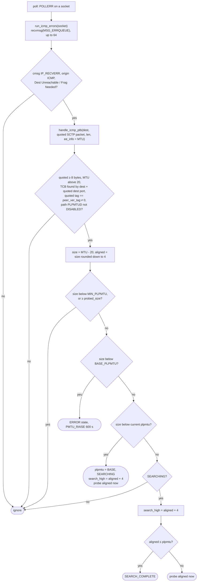
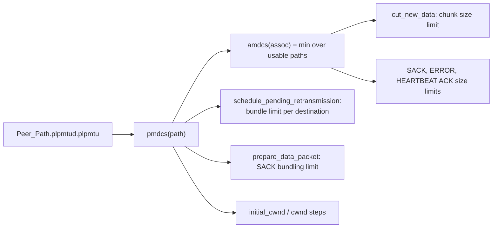

# 8. PMTU discovery

Sources: `src/socket/plpmtud.cpp`, `src/protocol/builders.cpp`
(`build_plpmtu_probe`), `src/socket/internal.hpp` (`pmdcs`, `amdcs`),
`include/sctp/protocol/sctp.hpp` (`plpmtud_parameters`),
`include/sctp/platform/compat.hpp` (DF, ICMP errors).

§7.3 requires PMTU discovery per destination. This stack implements it with
Datagram PLPMTUD (RFC 8899, §6.2 for SCTP and SCTP/UDP). Probes are
HEARTBEAT + PAD packets of an exact size, and ICMP Packet Too Big is used as a
hint where the OS reports it (Linux).

- [Size terms](#size-terms)
- [Per-path state machine](#per-path-state-machine)
- [The search](#the-search)
- [The probe packet](#the-probe-packet)
- [Black hole detection](#black-hole-detection)
- [ICMP Packet Too Big](#icmp-packet-too-big)
- [How the PMTU reaches DATA](#how-the-pmtu-reaches-data)
- [Parameters](#parameters)

---

## Size terms

```
 ┌──────────────────────────────── IP MTU (e.g. 1500) ───────────────────────────────┐
 │ IPv4 20 │ ┌──────────────────── UDP datagram = PLPMTU ───────────────────────────┐ │
 │         │ │ UDP 8 │ ┌──────────────── SCTP packet ─────────────────────────────┐ │ │
 │         │ │       │ │ common hdr 12 │ ┌──────── chunks: up to PMDCS ─────────┐ │ │ │
 │         │ │       │ │               │ │ DATA hdr 16 │ user data ...          │ │ │ │
 │         │ │       │ │               │ └──────────────────────────────────────┘ │ │ │
 │         │ │       │ └──────────────────────────────────────────────────────────┘ │ │
 │         │ └──────────────────────────────────────────────────────────────────────┘ │
 └───────────────────────────────────────────────────────────────────────────────────┘

 PLPMTU  = UDP datagram size the path carries         (RFC 8899: the PL packet for SCTP/UDP)
 PMDCS   = PLPMTU - 8 - 12                            pmdcs_of(plpmtu)
 AMDCS   = min PMDCS over CONFIRMED, active paths      amdcs(assoc)
```

| Name | Value | Meaning |
|---|---:|---|
| `MIN_PLPMTU` | 48 | 68-byte IPv4 minimum less the IP header |
| `BASE_PLPMTU` | 1200 | assumed to work, used until probing proves more |
| `BASE_PMDCS` | 1180 | chunk budget at the base size |
| `MAX_PLPMTU` | 1480 | 1500-byte Ethernet MTU less the IP header |

---

## Per-path state machine

`Plpmtud` lives on each `Peer_Path`. States follow RFC 8899 §5.2:



Where it starts and stops:

| Event | Call |
|---|---|
| Association established | `start_heartbeats()` calls `start_plpmtud()` on every path. Only CONFIRMED, active paths actually start. |
| Path confirmed by HEARTBEAT ACK | `start_plpmtud()` |
| Path back to active | `clear_path_errors()` calls `start_plpmtud()` |
| Path goes inactive | `count_path_error()` calls `stop_plpmtud()` |

The PLPMTU_PROBE timer **sends** the probe. `schedule_plpmtu_probe(delay)`
arms it, and `handle_plpmtu_probe_expiration` builds the probe and re-arms it
for `PROBE_TIMER`. This way a probe is built in exactly one place.

---

## The search



`search_high` is the smallest size known **not** to get through.
`plpmtu` is the largest size known to get through. Each probe size is tried up
to `MAX_PROBES` (3) times, `PROBE_TIMER` (15 s) apart, before it counts as
failed.

Example: the path silently drops UDP datagrams over 1380 bytes, and no ICMP
comes back:

| Probe | Result | plpmtu | search_high | Next |
|---:|---|---:|---:|---:|
| 1200 | acked | 1200 | 1481 | 1480 (try the top) |
| 1480 | lost ×3 (45 s) | 1200 | 1480 | (1200+1480)/2 = **1340** |
| 1340 | acked | 1340 | 1480 | 1410 → **1408** |
| 1408 | lost ×3 | 1340 | 1408 | **1372** |
| 1372 | acked | 1372 | 1408 | **1388** |
| 1388 | lost ×3 | 1372 | 1388 | **1380** |
| 1380 | acked | 1380 | 1388 | **1384** |
| 1384 | lost ×3 | 1380 | 1384 | 1382 → 1380 = not above plpmtu → **SEARCH_COMPLETE** |

PMTU_RAISE then re-runs the search every 600 s, starting from the top again.

An acked probe goes through `handle_plpmtu_probe_ack`. It also clears the
path's error count (and the association's, if this is the data path),
because a probe answer proves the path is alive.

---

## The probe packet

`build_plpmtu_probe(src, dst, tag, info, plpmtu)` makes the **UDP datagram**
exactly `plpmtu` bytes long:

```
 |<────────────────────────── probed_size bytes (UDP datagram) ───────────────────────────>|
 ┌───────┬───────────────┬────────────────────────────────────┬───────────┬────────────────┐
 │ UDP 8 │ SCTP hdr 12   │ HEARTBEAT 24                       │ PAD hdr 4 │ zeros          │
 │       │ tag = peer's  │  param hdr 4 + Info 14 + pad 2     │ type 0x84 │ (probed - 48)  │
 └───────┴───────────────┴────────────────────────────────────┴───────────┴────────────────┘
```

- The HEARTBEAT's Info has the same layout as a normal heartbeat's (see
  [Paths](07-paths.md#the-heartbeat-info)), but its nonce is stored in
  `plpmtud.probe_nonce`. `handle_heartbeat_ack` checks for it first, and routes
  a match to the PLPMTUD code instead of the heartbeat code.
- The peer skips PAD (type 0x84, upper bits `10`: skip without reporting) and
  echoes only the small Info back. The ACK is therefore never too large to get
  through.
- The socket has DF set, so the probe either arrives whole or does not arrive.
  A local `EMSGSIZE` from `sendto` is treated as a lost probe
  ([concurrency](02-concurrency.md#emsgsize-counts-as-sent)).

---

## Black hole detection

A path whose MTU shrinks with no ICMP would silently drop every full-size
packet. RFC 8899 §4.3: if DATA is lost on a path whose PLPMTU was raised above
the base, check whether the PLPMTU still works.



---

## ICMP Packet Too Big

On Linux each UDP socket has `IP_RECVERR` set, so ICMP errors are queued on
the socket and reported as `POLLERR`.



A PTB is only a **hint** (RFC 8899 §4.6). It can lower the search ceiling and
choose the next probe size, but `plpmtu` only goes **up** when a probe is
actually acked. Checking the quoted Verification Tag means an off-path attacker
who does not know the tag cannot shrink the PMTU. A tag of 0 would belong to
an INIT, and PLPMTUD never runs before the association is established.

---

## How the PMTU reaches DATA



When a path's PMTU **drops** after DATA was already cut to the larger size, the
chunks are not re-fragmented (§6.9 forbids it). A retransmission whose single
chunk exceeds the destination's PMDCS is built with `ip_fragment = true`.
`handle_send_packet` clears DF on that socket for that one `sendto()` and then
sets it again.

### DF on each platform

| Platform | DF on | DF off for `ip_fragment` |
|---|---|---|
| Linux | `IP_MTU_DISCOVER = IP_PMTUDISC_PROBE`: sets DF **and** ignores the kernel's PMTU cache, as RFC 8899 §4.5 requires of a DPLPMTUD sender | `IP_PMTUDISC_DONT` |
| Windows | `IP_DONTFRAGMENT = 1` | `0` |
| Other | not supported (`sctp_set_dont_fragment` returns false; logged at startup) | |

ICMP PTB is used only on Linux. Elsewhere, the search relies on probe loss
alone.

---

## Parameters

`include/sctp/protocol/sctp.hpp`, `namespace plpmtud_parameters`:

| Constant | Value |
|---|---|
| `MIN_PLPMTU` | 48 |
| `BASE_PLPMTU` | 1200 |
| `MAX_PLPMTU` | 1480 |
| `MAX_PROBES` | 3 |
| `PROBE_TIMER` | 15 s |
| `PMTU_RAISE_TIMER` | 600 s |
