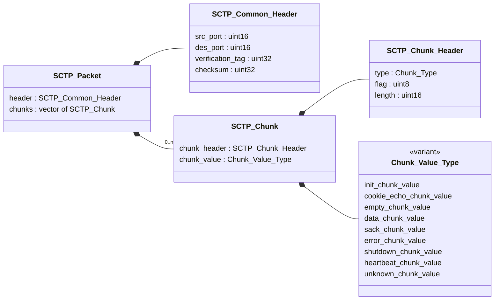
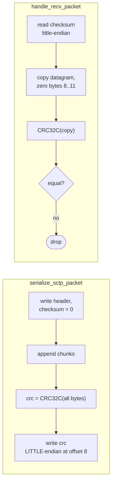
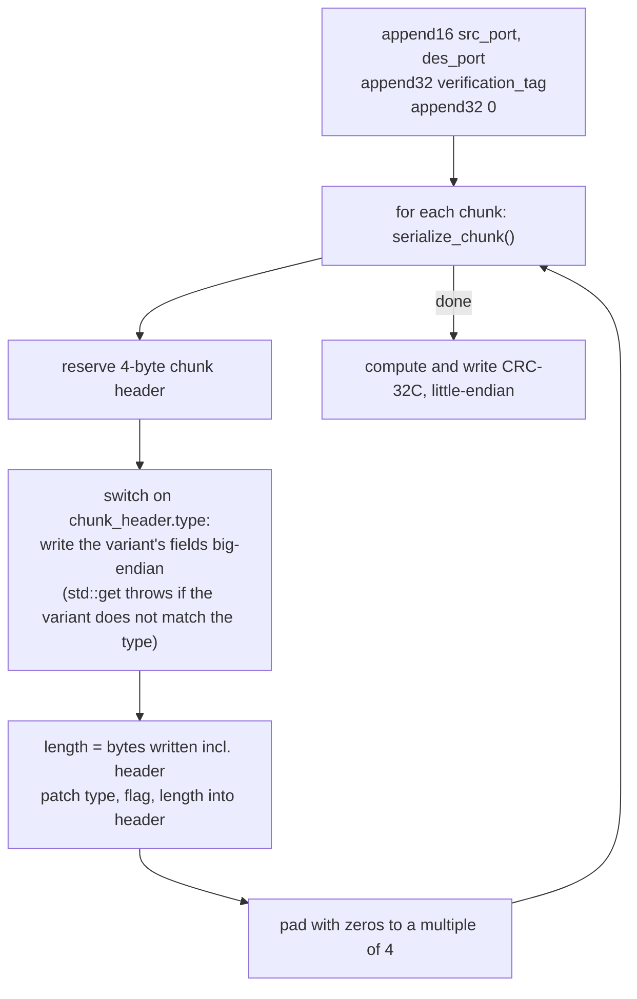
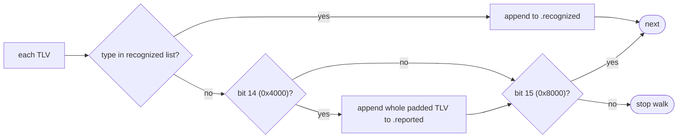

# 9. Wire format

Sources: `include/sctp/protocol/sctp.hpp`, `include/sctp/protocol/tsn.hpp`,
`src/protocol/serialize.{hpp,cpp}`, `src/protocol/builders.{hpp,cpp}`,
`src/protocol/checksum.{hpp,cpp}`.

The `protocol` module has no socket or platform dependencies, apart from
`htons`/`ntohl` in the codec. It is what the fuzz targets exercise.

- [In-memory model](#in-memory-model)
- [Packet layout](#packet-layout)
- [The checksum](#the-checksum)
- [Serializing](#serializing)
- [Deserializing](#deserializing)
- [Parameters and the upper-bit rules](#parameters-and-the-upper-bit-rules)
- [Chunk layouts](#chunk-layouts)
- [Builders](#builders)
- [Error causes](#error-causes)
- [Serial number arithmetic](#serial-number-arithmetic)

---

## In-memory model



> **Every multi-byte field in these structs is in host byte order.** Only the
> codec converts. This is also why the `*_SIZE` constants in `sctp.hpp` are
> **not** `sizeof()` of these structs.

| Chunk type | Code | Variant alternative | Notes |
|---|---:|---|---|
| DATA | 0 | `data_chunk_value` | `flags` holds U/B/E. The I bit lives only on the chunk header. |
| INIT | 1 | `init_chunk_value` | optional parameters kept as raw TLV bytes |
| INIT ACK | 2 | `init_chunk_value` | same struct |
| SACK | 3 | `sack_chunk_value` | |
| HEARTBEAT | 4 | `heartbeat_chunk_value` | just the Heartbeat Info *value* |
| HEARTBEAT ACK | 5 | `heartbeat_chunk_value` | |
| ABORT | 6 | `error_chunk_value` | list of `error_cause{code, info}` |
| SHUTDOWN | 7 | `shutdown_chunk_value` | |
| SHUTDOWN ACK | 8 | `empty_chunk_value` | |
| ERROR | 9 | `error_chunk_value` | enum name `OP_ERROR` |
| COOKIE ECHO | 10 | `cookie_echo_chunk_value` | opaque cookie bytes |
| COOKIE ACK | 11 | `empty_chunk_value` | |
| SHUTDOWN COMPLETE | 14 | `empty_chunk_value` | |
| PAD (RFC 4820) | 0x84 | `unknown_chunk_value` | only built for PLPMTU probes |
| anything else | | `unknown_chunk_value` | body kept raw. The upper type bits decide its fate. |

`data_chunk_value.payload_protocal` is the PPID. The field name keeps its
original spelling.

---

## Packet layout

```
 0                   1                   2                   3
 0 1 2 3 4 5 6 7 8 9 0 1 2 3 4 5 6 7 8 9 0 1 2 3 4 5 6 7 8 9 0 1
+-+-+-+-+-+-+-+-+-+-+-+-+-+-+-+-+-+-+-+-+-+-+-+-+-+-+-+-+-+-+-+-+
|      Source Port Number       |    Destination Port Number    |   big-endian
+-+-+-+-+-+-+-+-+-+-+-+-+-+-+-+-+-+-+-+-+-+-+-+-+-+-+-+-+-+-+-+-+
|                       Verification Tag                        |   big-endian
+-+-+-+-+-+-+-+-+-+-+-+-+-+-+-+-+-+-+-+-+-+-+-+-+-+-+-+-+-+-+-+-+
|                     Checksum (CRC-32C)                        |   LITTLE-endian
+-+-+-+-+-+-+-+-+-+-+-+-+-+-+-+-+-+-+-+-+-+-+-+-+-+-+-+-+-+-+-+-+
|  Chunk Type   |  Chunk Flags  |         Chunk Length          |   ┐
+-+-+-+-+-+-+-+-+-+-+-+-+-+-+-+-+-+-+-+-+-+-+-+-+-+-+-+-+-+-+-+-+   │ chunk 1
\                    Chunk Value ... + 0-3 pad                  \   ┘
+-+-+-+-+-+-+-+-+-+-+-+-+-+-+-+-+-+-+-+-+-+-+-+-+-+-+-+-+-+-+-+-+
\                           chunk 2 ...                         \
+-+-+-+-+-+-+-+-+-+-+-+-+-+-+-+-+-+-+-+-+-+-+-+-+-+-+-+-+-+-+-+-+
```

- **Chunk Length** counts the 4-byte header and the value, but **not** the
  trailing padding.
- Each chunk is padded with zeros to a multiple of 4. The **last** chunk in a
  packet may omit its padding, and the parser accepts that.

---

## The checksum

CRC-32C (Castagnoli), table-driven, using the reflected polynomial
`0x82F63B78`. It is computed over the whole SCTP packet with the checksum field
set to zero.



> **The CRC is the one field that is not big-endian.** It goes on the wire
> least significant byte first (§6.8 via RFC 3309). `write_checksum_le` and
> `read_checksum_le` exist so that it is never accidentally written with
> `append32`. `tests/unit/wire.cpp` checks it against published check vectors,
> not against our own output: a round-trip test cannot catch a CRC that is
> wrong on both ends.

---

## Serializing

`serialize_sctp_packet(pkt)`:



Points worth knowing:

- **The value comes from the variant, the type from the header.** For a DATA
  chunk, the header flag is written as given. The builders copy
  `data.flags` into it, and `prepare_data_packet` ORs in the I bit.
- **Lengths are computed, never trusted.** `chunk_header.length` is ignored on
  output and recomputed.
- **HEARTBEAT / HEARTBEAT ACK** wrap `info` in a Heartbeat Info parameter
  (type 1).
- **ERROR / ABORT** write each cause as a TLV: `code`, `length`, `info`, padding.
- **`unknown_chunk_value`** writes its body raw. Tests use this to put
  arbitrary chunks on the wire, and PAD uses it too.

---

## Deserializing

`deserialize_sctp_packet(data, len)` **throws** on anything malformed.
`handle_recv_packet` catches the exception and drops the datagram.

| Check | Throws |
|---|---|
| fewer than 12 bytes | `buffer underflow` |
| fewer than 4 bytes left for a chunk header | `truncated chunk header` |
| Chunk Length below 4, or past the end | `chunk length out of range` |
| INIT / INIT ACK value below 16 bytes | `INIT chunk too short` |
| DATA value below 12 bytes | `DATA chunk too short` |
| SHUTDOWN value not exactly 4 bytes | `SHUTDOWN chunk has wrong length` |
| HEARTBEAT(ACK) without a Heartbeat Info parameter | `... no Heartbeat Info parameter` |
| SACK below 12 bytes, or the counts do not match the length | `SACK chunk too short` / `inconsistent counts` |
| Gap Ack Block with start 0, end below start, or not ascending and disjoint | `invalid gap ack block` |
| ERROR / ABORT cause with a bad length | `ERROR chunk has a malformed cause` |

Not checked here: an empty DATA payload. That is a protocol error, not a
parsing error, and the handler ABORTs for it (§3.3.1). After parsing a DATA
chunk, U/B/E are copied from the header flag into `data_chunk_value.flags`.

`fuzz/fuzz_packet.cpp` requires that anything that parses re-serializes and
parses back to the same chunks.

---

## Parameters and the upper-bit rules

Parameters are TLVs with the same 4-byte header shape as chunks: type (16),
length (16, header included, padding excluded), value, padding to 4.

| Function | Purpose |
|---|---|
| `append_parameter(out, type, value, len)` | write one TLV with padding. Throws if longer than 65535. |
| `walk_tlvs(data, len, visit)` (internal) | iterate TLVs. A Length below 4 or past the end stops the walk (returns false). |
| `find_parameter(params, type, out)` | value of the first TLV of that type |
| `find_ipv4_addresses(params)` | every IPv4 Address (type 5, length 8), in host order |
| `scan_parameters(params, recognized)` | split into recognized TLVs and ones to report, by the upper bits |

`scan_parameters` applies §3.2.1 to INIT and INIT ACK:

```
 type bits 15 14   action for an unrecognized parameter
 ───────────────   ────────────────────────────────────────────
       0 0         stop processing parameters
       0 1         stop, and report it
       1 0         skip it, continue
       1 1         skip, continue, and report it
```



| | Recognized types |
|---|---|
| in INIT (`scan_init`) | IPv4 Address 5, IPv6 Address 6, Cookie Preservative 9, Host Name Address 11, Supported Address Types 12 |
| in INIT ACK (`scan_init_ack`) | State Cookie 7, IPv4 Address 5, IPv6 Address 6, Unrecognized Parameter 8, Host Name Address 11 |

Reported parameters go back as Unrecognized Parameter TLVs (type 8) inside the
INIT ACK, or as an ERROR with cause 8 bundled after the COOKIE ECHO. Either way
they are trimmed so the packet fits. IPv6 Address is recognized, so it is not
reported, but it is otherwise ignored: the stack is IPv4-only.

---

## Chunk layouts

### DATA

```
 0                   1                   2                   3
 0 1 2 3 4 5 6 7 8 9 0 1 2 3 4 5 6 7 8 9 0 1 2 3 4 5 6 7 8 9 0 1
+-+-+-+-+-+-+-+-+-+-+-+-+-+-+-+-+-+-+-+-+-+-+-+-+-+-+-+-+-+-+-+-+
|   Type = 0    |  Res  |I|U|B|E|            Length             |
+-+-+-+-+-+-+-+-+-+-+-+-+-+-+-+-+-+-+-+-+-+-+-+-+-+-+-+-+-+-+-+-+
|                              TSN                              |
+-+-+-+-+-+-+-+-+-+-+-+-+-+-+-+-+-+-+-+-+-+-+-+-+-+-+-+-+-+-+-+-+
|      Stream Identifier S      |   Stream Sequence Number n    |
+-+-+-+-+-+-+-+-+-+-+-+-+-+-+-+-+-+-+-+-+-+-+-+-+-+-+-+-+-+-+-+-+
|                  Payload Protocol Identifier                  |
+-+-+-+-+-+-+-+-+-+-+-+-+-+-+-+-+-+-+-+-+-+-+-+-+-+-+-+-+-+-+-+-+
\                     User Data (seq n of Stream S)             \
+-+-+-+-+-+-+-+-+-+-+-+-+-+-+-+-+-+-+-+-+-+-+-+-+-+-+-+-+-+-+-+-+

 E 0x01 DATA_FLAG_E   last fragment
 B 0x02 DATA_FLAG_B   first fragment
 U 0x04 DATA_FLAG_U   unordered
 I 0x08 DATA_IMMEDIATE_SACK_FLAG (internal.hpp)  set per transmission only
```

`data_chunk_wire_size(d)` = `(16 + payload + 3) & ~3`, the padded footprint.
Windows, flight size and bundling are all counted in this unit.

### SACK

```
+-+-+-+-+-+-+-+-+-+-+-+-+-+-+-+-+-+-+-+-+-+-+-+-+-+-+-+-+-+-+-+-+
|   Type = 3    |  Flags = 0    |            Length             |
+-+-+-+-+-+-+-+-+-+-+-+-+-+-+-+-+-+-+-+-+-+-+-+-+-+-+-+-+-+-+-+-+
|                      Cumulative TSN Ack                       |
+-+-+-+-+-+-+-+-+-+-+-+-+-+-+-+-+-+-+-+-+-+-+-+-+-+-+-+-+-+-+-+-+
|          Advertised Receiver Window Credit (a_rwnd)           |
+-+-+-+-+-+-+-+-+-+-+-+-+-+-+-+-+-+-+-+-+-+-+-+-+-+-+-+-+-+-+-+-+
| Number of Gap Ack Blocks = N  |  Number of Duplicate TSNs = M |
+-+-+-+-+-+-+-+-+-+-+-+-+-+-+-+-+-+-+-+-+-+-+-+-+-+-+-+-+-+-+-+-+
|  Gap Ack Block #1 Start       |   Gap Ack Block #1 End        |   offsets from Cumulative TSN Ack
+-+-+-+-+-+-+-+-+-+-+-+-+-+-+-+-+-+-+-+-+-+-+-+-+-+-+-+-+-+-+-+-+
\                              ...                              \
+-+-+-+-+-+-+-+-+-+-+-+-+-+-+-+-+-+-+-+-+-+-+-+-+-+-+-+-+-+-+-+-+
|                       Duplicate TSN 1                         |
+-+-+-+-+-+-+-+-+-+-+-+-+-+-+-+-+-+-+-+-+-+-+-+-+-+-+-+-+-+-+-+-+
\                              ...                              \
```

### INIT / INIT ACK

```
+-+-+-+-+-+-+-+-+-+-+-+-+-+-+-+-+-+-+-+-+-+-+-+-+-+-+-+-+-+-+-+-+
|  Type = 1 / 2  |  Flags = 0    |            Length             |
+-+-+-+-+-+-+-+-+-+-+-+-+-+-+-+-+-+-+-+-+-+-+-+-+-+-+-+-+-+-+-+-+
|                         Initiate Tag                          |
+-+-+-+-+-+-+-+-+-+-+-+-+-+-+-+-+-+-+-+-+-+-+-+-+-+-+-+-+-+-+-+-+
|          Advertised Receiver Window Credit (a_rwnd)           |   we send RWND = 65535
+-+-+-+-+-+-+-+-+-+-+-+-+-+-+-+-+-+-+-+-+-+-+-+-+-+-+-+-+-+-+-+-+
|  Number of Outbound Streams   |  Number of Inbound Streams    |   we send 10 / 65535
+-+-+-+-+-+-+-+-+-+-+-+-+-+-+-+-+-+-+-+-+-+-+-+-+-+-+-+-+-+-+-+-+
|                          Initial TSN                          |
+-+-+-+-+-+-+-+-+-+-+-+-+-+-+-+-+-+-+-+-+-+-+-+-+-+-+-+-+-+-+-+-+
\              Optional/Variable-Length Parameters              \   init_chunk_value.optional_parameters
+-+-+-+-+-+-+-+-+-+-+-+-+-+-+-+-+-+-+-+-+-+-+-+-+-+-+-+-+-+-+-+-+
```

---

## Builders

`src/protocol/builders.{hpp,cpp}`. Every function returns an `SCTP_Packet`;
nothing is serialized here. Ports and tags are in host order.

| Builder | Produces |
|---|---|
| `build_packet(src, dst, tag, type, value, flag)` | a packet with one chunk |
| `build_init(src, dst, initiate_tag, tsn, preservative_ms, addresses)` | INIT with Verification Tag 0, our IPv4 addresses, and an optional Cookie Preservative |
| `build_init_ack(src, dst, peer_tag, initiate_tag, tsn, cookie, unrecognized, addresses)` | INIT ACK: State Cookie, IPv4 addresses, Unrecognized Parameters |
| `build_data(src, dst, peer_tag, chunks)` | one packet with several DATA chunks, each chunk's header flag = `data.flags` |
| `build_plpmtu_probe(src, dst, tag, info, plpmtu)` | HEARTBEAT + PAD with the UDP datagram exactly `plpmtu` bytes |

INIT and INIT ACK always advertise `a_rwnd = RWND` (65535),
`OS = LOCAL_OUT_STREAMS` (10) and `MIS = LOCAL_MAX_IN_STREAMS` (65535).

> **Port byte order trap.** `sockaddr_in.sin_port` is in network order, and
> the builders take host order. Call sites therefore pass
> `ntohs(local_address.sin_port)`, not `htons`.

---

## Error causes

Causes this stack **sends**:

| Code | Cause | Chunk | Sent when | Where |
|---:|---|---|---|---|
| 1 | Invalid Stream Identifier | ERROR | DATA on stream ≥ negotiated inbound streams | `handle_data_packet` |
| 2 | Missing Mandatory Parameter | ABORT | INIT ACK without a State Cookie | `handle_init_ack` |
| 3 | Stale Cookie | ERROR | COOKIE ECHO past its lifespan (staleness in µs) | `handle_cookie_echo` |
| 5 | Unresolvable Address | ABORT | Host Name Address in INIT / INIT ACK | `handle_init`, `handle_init_ack` |
| 6 | Unrecognized Chunk Type | ERROR | chunk type with upper bits 01 or 11 | `report_unrecognized_chunks` |
| 7 | Invalid Mandatory Parameter | ABORT | Initiate Tag 0, or OS / MIS 0 | `handle_init`, `handle_init_ack` |
| 8 | Unrecognized Parameters | ERROR (bundled with COOKIE ECHO) | INIT ACK parameter with bit 14 set | `handle_init_ack` |
| 9 | No User Data | ABORT | DATA with an empty payload | `handle_data_packet` |
| 10 | Cookie Received While Shutting Down | ERROR | restart cookie (case A) in `SHUTDOWN_ACK_SENT` | `handle_cookie_echo` |
| 11 | Restart With New Addresses | ABORT | INIT for an existing association lists a new address | `handle_init` |
| 12 | User-Initiated Abort | ABORT | `sctp_abort()` | `api.cpp` |
| 13 | Protocol Violation | ABORT | SACK or SHUTDOWN acks an unsent TSN, broken DATA framing | `handlers.cpp` |

Cause 4 (Out of Resource) is never sent.

Received ERROR chunks: a Stale Cookie cause in `COOKIE_ECHOED` triggers
[recovery](03-association-lifecycle.md#stale-cookie-recovery). Everything else,
including unknown codes, goes to the ULP as `SCTP_REMOTE_ERROR` with all its
causes.

---

## Serial number arithmetic

`include/sctp/protocol/tsn.hpp`. TSNs are 32-bit and SSNs 16-bit, both
compared using RFC 1982 serial arithmetic:

```
tsn_lt(a, b):  d = b - a  (mod 2^32)      a < b  ⇔  d ≠ 0 and d < 2^31

                       0
               2^32-1  ●  1
                    ·     ·
          "behind" ·   a   · "ahead"
                   ·   ●   ·
                    ·     ·  ← up to 2^31 - 1 ahead of a counts as greater
                       ·
```

| Function | Bits | Use |
|---|---:|---|
| `tsn_lt / lte / gt / gte` | 32 | every TSN comparison |
| `Tsn_Less` | 32 | comparator for `std::map` keyed by TSN (`outstanding_data`, `tsn_ooo_buffer`) |
| `ssn_gt` | 16 | ordering per stream |
| `sack_acknowledges(sack, tsn)` | 32 | is `tsn` ≤ cum ack, or inside a gap block? Offsets above 65535 can never be covered. |

> `Tsn_Less` is a strict weak ordering **only** while every key lies within
> half the TSN space of the others. That holds because `outstanding_data` is
> bounded by the windows, and `tsn_ooo_buffer` is bounded to 65535 above the
> ack point.
