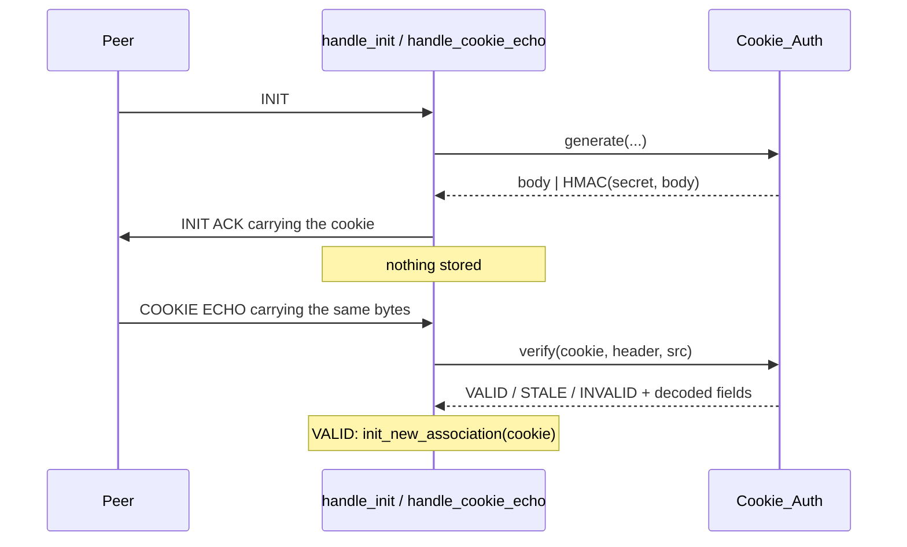
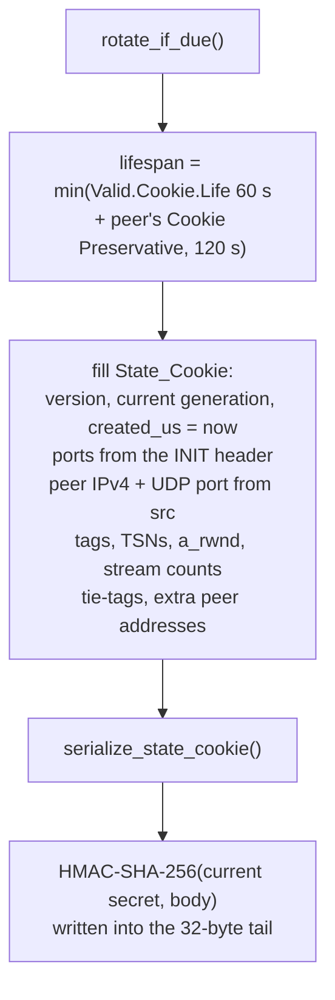
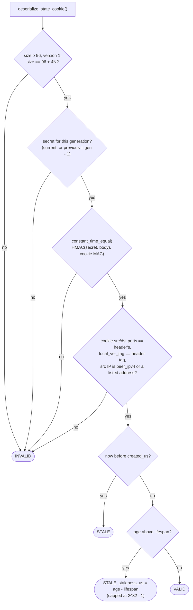
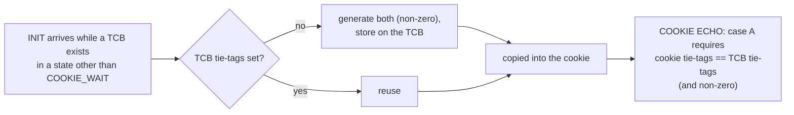

# 10. State cookies and crypto

Sources: `include/sctp/crypto/cookie_auth.hpp`, `src/crypto/cookie_auth.cpp`,
`src/crypto/hmac.{hpp,cpp}`, `src/protocol/serialize.cpp`
(`serialize_state_cookie`, `deserialize_state_cookie`),
`include/sctp/platform/compat.hpp` (`random_bytes`),
`src/socket/internal.hpp` (`generate_random`, `generate_nonzero_tag`).

- [Why a cookie](#why-a-cookie)
- [Cookie layout](#cookie-layout)
- [Generating](#generating)
- [Verifying](#verifying)
- [Secret rotation](#secret-rotation)
- [Tie-tags](#tie-tags)
- [What each check defends against](#what-each-check-defends-against)
- [SHA-256 and HMAC](#sha-256-and-hmac)
- [Randomness](#randomness)

---

## Why a cookie

The responder answers an INIT without keeping any state. Everything it would
otherwise remember goes into the State Cookie, signed with a secret only it
knows. The cookie comes back in the COOKIE ECHO, and only then is a TCB
created (§5.1.3). A flood of forged INITs therefore costs one HMAC each and no
memory.



---

## Cookie layout

`STATE_COOKIE_BODY_SIZE` = 64, plus 4 bytes per extra peer address, plus
`STATE_COOKIE_MAC_SIZE` = 32. All fields are big-endian.

```
 0                   1                   2                   3
 0 1 2 3 4 5 6 7 8 9 0 1 2 3 4 5 6 7 8 9 0 1 2 3 4 5 6 7 8 9 0 1
+-+-+-+-+-+-+-+-+-+-+-+-+-+-+-+-+-+-+-+-+-+-+-+-+-+-+-+-+-+-+-+-+
|  version = 1  | secret gen.   |        reserved (0)           |  0
+-+-+-+-+-+-+-+-+-+-+-+-+-+-+-+-+-+-+-+-+-+-+-+-+-+-+-+-+-+-+-+-+
|                created_us (steady_clock µs, 64 bits)          |  4
|                                                               |
+-+-+-+-+-+-+-+-+-+-+-+-+-+-+-+-+-+-+-+-+-+-+-+-+-+-+-+-+-+-+-+-+
|                         lifespan_us                           | 12
+-+-+-+-+-+-+-+-+-+-+-+-+-+-+-+-+-+-+-+-+-+-+-+-+-+-+-+-+-+-+-+-+
|    sctp_src_port (peer's)     |    sctp_dst_port (ours)       | 16
+-+-+-+-+-+-+-+-+-+-+-+-+-+-+-+-+-+-+-+-+-+-+-+-+-+-+-+-+-+-+-+-+
|               peer_ipv4 (the INIT's source)                   | 20
+-+-+-+-+-+-+-+-+-+-+-+-+-+-+-+-+-+-+-+-+-+-+-+-+-+-+-+-+-+-+-+-+
|  peer_udp_port (INIT's source)|  N = number of extra addresses| 24
+-+-+-+-+-+-+-+-+-+-+-+-+-+-+-+-+-+-+-+-+-+-+-+-+-+-+-+-+-+-+-+-+
|            local_ver_tag (our Initiate Tag in INIT ACK)       | 28
+-+-+-+-+-+-+-+-+-+-+-+-+-+-+-+-+-+-+-+-+-+-+-+-+-+-+-+-+-+-+-+-+
|            peer_ver_tag (the INIT's Initiate Tag)             | 32
+-+-+-+-+-+-+-+-+-+-+-+-+-+-+-+-+-+-+-+-+-+-+-+-+-+-+-+-+-+-+-+-+
|                      local_initial_tsn                        | 36
+-+-+-+-+-+-+-+-+-+-+-+-+-+-+-+-+-+-+-+-+-+-+-+-+-+-+-+-+-+-+-+-+
|                      peer_initial_tsn                         | 40
+-+-+-+-+-+-+-+-+-+-+-+-+-+-+-+-+-+-+-+-+-+-+-+-+-+-+-+-+-+-+-+-+
|                        peer_a_rwnd                            | 44
+-+-+-+-+-+-+-+-+-+-+-+-+-+-+-+-+-+-+-+-+-+-+-+-+-+-+-+-+-+-+-+-+
|  local_out_streams (OS sent)  |  local_in_streams (MIS sent)  | 48
+-+-+-+-+-+-+-+-+-+-+-+-+-+-+-+-+-+-+-+-+-+-+-+-+-+-+-+-+-+-+-+-+
|  peer_out_streams             |  peer_in_streams              | 52
+-+-+-+-+-+-+-+-+-+-+-+-+-+-+-+-+-+-+-+-+-+-+-+-+-+-+-+-+-+-+-+-+
|                        local_tie_tag                          | 56
+-+-+-+-+-+-+-+-+-+-+-+-+-+-+-+-+-+-+-+-+-+-+-+-+-+-+-+-+-+-+-+-+
|                        peer_tie_tag                           | 60
+-+-+-+-+-+-+-+-+-+-+-+-+-+-+-+-+-+-+-+-+-+-+-+-+-+-+-+-+-+-+-+-+
|                 extra peer IPv4 address 1                     | 64
+-+-+-+-+-+-+-+-+-+-+-+-+-+-+-+-+-+-+-+-+-+-+-+-+-+-+-+-+-+-+-+-+
\                       ... N addresses ...                     \
+-+-+-+-+-+-+-+-+-+-+-+-+-+-+-+-+-+-+-+-+-+-+-+-+-+-+-+-+-+-+-+-+
|                                                               | 64 + 4N
|              HMAC-SHA-256(secret[gen], bytes before)          |
|                          32 bytes                             |
+-+-+-+-+-+-+-+-+-+-+-+-+-+-+-+-+-+-+-+-+-+-+-+-+-+-+-+-+-+-+-+-+
```

`serialize_state_cookie` throws if the fixed body does not come out at exactly
64 bytes. Adding a field without updating `STATE_COOKIE_BODY_SIZE` would move
the MAC boundary and silently break every cookie. The MAC is a plain suffix,
so `generate()` serializes once and writes the HMAC straight into the last 32
bytes.

---

## Generating

`Cookie_Auth::generate(header, init, src, local_tag, local_tsn, local_tie,
peer_tie, lifespan_increment_ms, peer_addresses)`:



The stream counts stored are **what we advertised** (10 / 65535) and **what
the peer advertised**. `init_new_association(cookie)` takes the minimum of each
pair when the cookie returns.

---

## Verifying

`Cookie_Auth::verify(cookie, header, src, out, staleness_us)`:



What the caller does with each result is in
[Table 12](03-association-lifecycle.md#handle_cookie_echo-table-12):

- `INVALID` silently discards the whole packet.
- `STALE` gets an ERROR with a Stale Cookie cause, **except** when both tags
  match an existing TCB (case D, a retransmitted echo), which is accepted.
- `VALID` goes through the Table 12 cases.

The COOKIE ECHO's source port and address are compared with the INIT's,
because both packets come from the peer to us. No swapping is needed.

---

## Secret rotation

```mermaid
gantt
    title Cookie secrets over time (rotation every 60 min, cookie life at most 120 s)
    dateFormat HH:mm
    axisFormat %H:%M
    section gen 0
    signs new cookies       :g0s, 00:00, 60m
    verifies only           :g0v, after g0s, 60m
    section gen 1
    signs new cookies       :g1s, 01:00, 60m
    verifies only           :g1v, after g1s, 60m
    section gen 2
    signs new cookies       :g2s, 02:00, 60m
```



- The first secret is drawn lazily on the first `generate()`.
- Every `COOKIE_SECRET_ROTATION` (60 min), `current` moves to `previous` and a
  new `current` is drawn. The 8-bit `generation` counter increments and wraps.
- A cookie names its generation. Only `generation` and `generation - 1` can
  verify.
- `static_assert(MAX_COOKIE_LIFE < COOKIE_SECRET_ROTATION)` ensures any cookie
  still inside its lifespan has its secret retained.
- `created_us` comes from `steady_clock`, which is monotonic and per process.
  Cookies do not survive a restart, and do not need to: the secrets do not
  survive it either.
- `Cookie_Auth::clock` is a `std::function`, so tests can move time forward
  without waiting (`SCTP_Socket_Test_Access::cookies(s).clock = ...`).

---

## Tie-tags

Tie-tags let a COOKIE ECHO prove that it answers an INIT ACK sent **while the
current TCB existed**. That is what tells a genuine peer restart (case A) apart
from a stale cookie.



In every other situation they are 0, which means "none" and never matches.

---

## What each check defends against

| Check | Stops |
|---|---|
| No state until COOKIE ECHO | memory exhaustion by INIT floods |
| HMAC-SHA-256 with a 256-bit random secret | forging a cookie, and so creating a TCB without a round trip |
| `constant_time_equal` on the MAC | finding a valid MAC byte by byte through timing (`memcmp` returns early) |
| header tag == `local_ver_tag` | replaying a cookie into a different association |
| source address listed in the cookie | replaying a captured cookie from elsewhere |
| ports in the cookie == header ports | moving a cookie to another port pair |
| lifespan, capped at 120 s | replaying old cookies |
| rotation, keeping only two generations | how long a leaked secret stays useful |
| non-zero random Verification Tags and TSNs | blind injection into an association |

---

## SHA-256 and HMAC

`src/crypto/hmac.{hpp,cpp}`, internal (not installed):

| Function | Spec | Tested against |
|---|---|---|
| `sha256(data, len, out)` | FIPS 180-4 | FIPS 180-4 vectors (`tests/unit/hmac.cpp`) |
| `hmac_sha256(key, key_len, data, len, out)` | RFC 2104 | RFC 4231 vectors |
| `constant_time_equal(a, b, len)` | | |

These are in-tree for the same reason as CRC-32C: the library links nothing
but pthreads. The tests use **published** vectors on purpose. A cookie
signed and verified with the same broken hash still round-trips, so only an
external reference can catch that.

---

## Randomness

`random_bytes(buf, len)` in `compat.hpp`:

| Platform | Source | On failure |
|---|---|---|
| Linux / POSIX | `getrandom(buf, len, 0)`, looped for partial reads and EINTR | throws `std::runtime_error` |
| Windows | `BCryptGenRandom(..., BCRYPT_USE_SYSTEM_PREFERRED_RNG)` | throws |

Helpers in `internal.hpp`:

- `generate_random(x)` fills any trivially-copyable object.
- `generate_nonzero_tag()` redraws until the value is non-zero. Initiate Tags
  and tie-tags come from 1..2³²-1. 0 is reserved for INIT, and inside a cookie
  it means "no tie-tag".

Used for: Verification Tags, initial TSNs, tie-tags, heartbeat and PLPMTU
probe nonces, heartbeat jitter, and cookie secrets. `tests/unit/random.cpp`
checks the wrapper (full fills, odd lengths, whole-object coverage), not the
OS generator's statistics.
