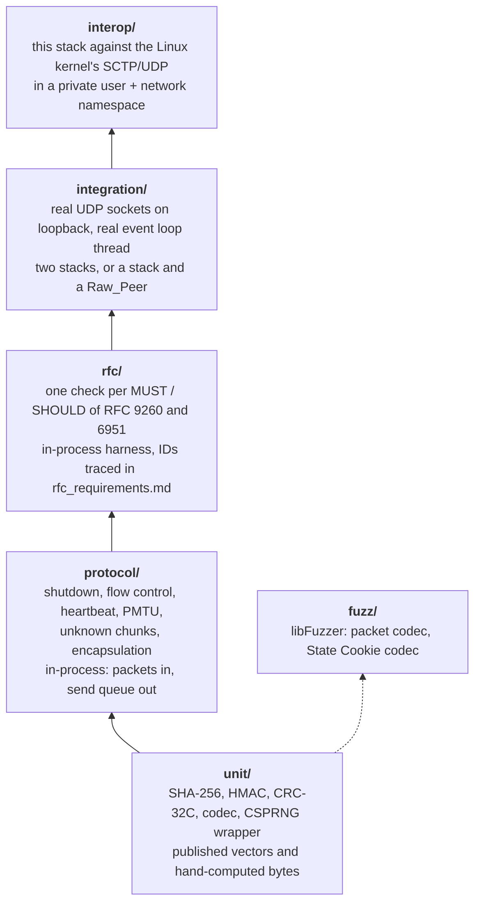
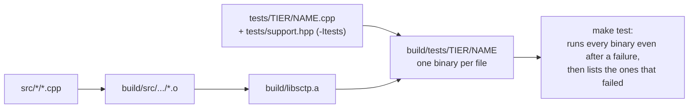
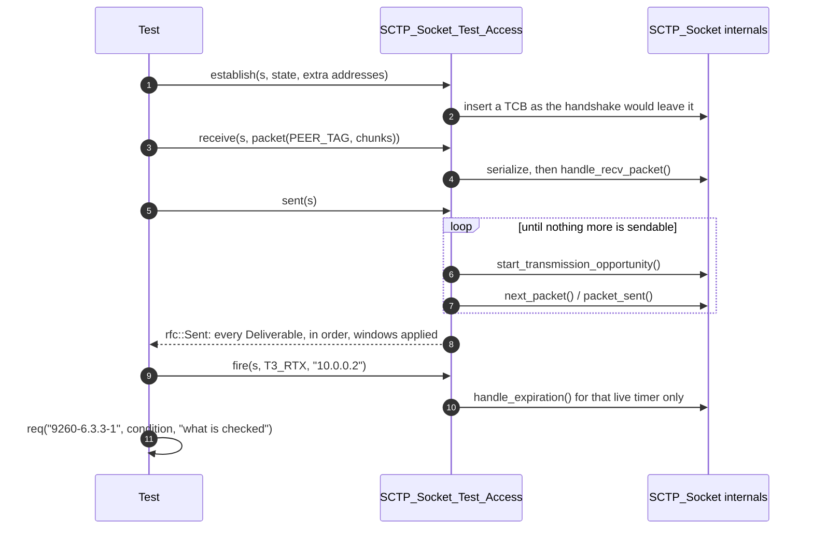
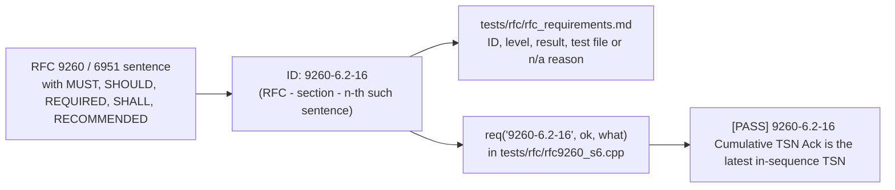
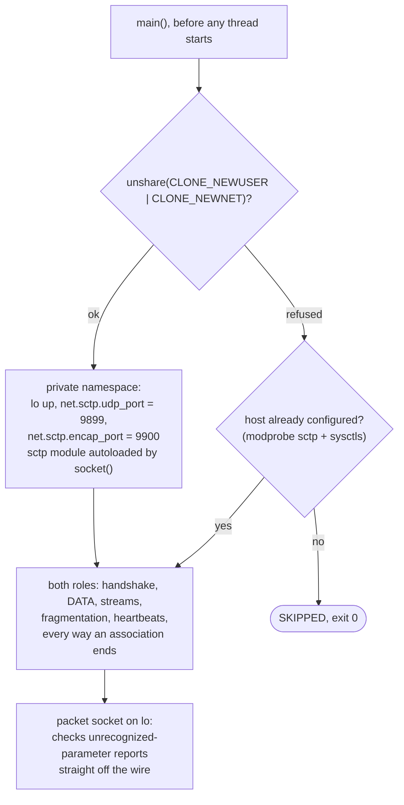
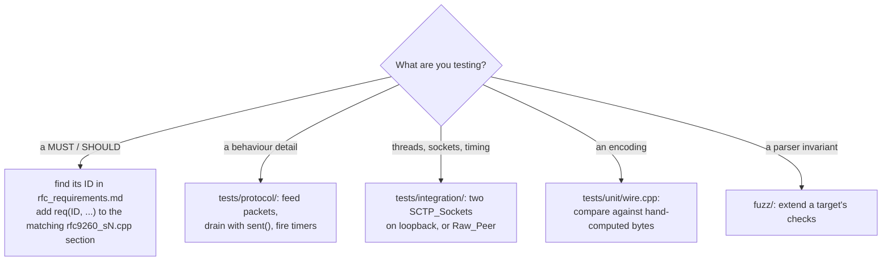

# 11. Testing

Sources: `tests/`, `fuzz/`, `Makefile`.

- [Test tiers](#test-tiers)
- [How tests are built and run](#how-tests-are-built-and-run)
- [The in-process harness](#the-in-process-harness)
- [Requirement traceability](#requirement-traceability)
- [Integration tests and `Raw_Peer`](#integration-tests-and-raw_peer)
- [Kernel interop](#kernel-interop)
- [Fuzzing](#fuzzing)
- [Sanitizers](#sanitizers)
- [Adding a test](#adding-a-test)

---

## Test tiers



| Directory | Peer | Event loop | Clock | What it catches |
|---|---|---|---|---|
| `unit/` | none | no | n/a | encoding errors that would be symmetric (both ends equally wrong) |
| `protocol/` | packets built in the test | no: drained by hand | timers fired by hand | a behaviour's details, deterministically |
| `rfc/` | packets built in the test | no | timers fired by hand | each normative sentence, by ID |
| `integration/` | a second `SCTP_Socket`, or `Raw_Peer` | yes | real | threading, wakeups, real sockets |
| `interop/` | Linux kernel SCTP | yes | real | bugs our encoder and our tests agree on |
| `fuzz/` | random bytes | no | n/a | parser crashes, round-trip mismatches |

Why "externally fixed" matters: `tests/unit/wire.cpp` and `tests/unit/hmac.cpp`
compare against RFC check vectors and hand-computed byte layouts, never
against the library's own output. A CRC-32C polynomial bug once survived
loopback tests because both ends shared it.

---

## How tests are built and run



- Every `tests/*/*.cpp` is a standalone program with its own `main()`. The
  Makefile picks new files up automatically by wildcard.
- A binary prints `[PASS]` / `[FAIL]` lines and exits non-zero on any failure.
- Tests may include internal headers (`"socket/internal.hpp"`,
  `"protocol/serialize.hpp"`), because `-Isrc` is on the include path.
- White-box access goes through `struct SCTP_Socket_Test_Access`, which
  `SCTP_Socket`, `Send_Queue`, `Receive_Queue` and `Expiration_Queue` declare
  as a `friend`. Each test tier defines its own version of that struct.

---

## The in-process harness

`tests/rfc/rfc_harness.hpp` drives a real `SCTP_Socket` **without** its
event loop, sockets, or wall-clock waits:



`sent()` runs the same `next_packet()` / `packet_sent()` pair that
`run_sending()` uses, minus `sendto()`. Windows, Max.Burst, bundling, the I
bit, and every timer armed on send behave exactly as they do on the wire.

Useful helpers:

| Helper | Does |
|---|---|
| `establish(s, state, others, peer_rwnd)` | creates a TCB with fixed tags (`OUR_TAG`, `PEER_TAG`) and TSNs (`OUR_TSN`, `PEER_TSN`). Extra peer addresses start CONFIRMED. |
| `key(s, ip, port)` | the id `s` holds for that peer, or the last one it held once the association is gone, so teardown checks still look under the right id. Helpers that take an `Association_Key` default to the default peer's. |
| `initiate(s, ...)` / `respond(s, init, bundled)` | runs a real handshake in either role and returns each step's packets |
| `receive(s, packet)` / `receive_wire(s, bytes)` | feed a parsed or raw packet in |
| `sent(s)` / `sent_once(s)` | drain the send queue: all passes, or one transmission opportunity |
| `armed(s, type, ip)`, `remaining(...)`, `generation(...)` | inspect timers. A restart changes the generation. |
| `fire(s, type, ip)` | expire one running timer now |
| `cookies(s)` | the `Cookie_Auth`, for moving its clock |
| `handle_icmp_ptb(...)`, `icmp(s)` | inject or receive a real PTB |
| `notifications(s)`, `notified(ns, state)` | read and check notifications |
| `rfc::packet`, `chunk`, `data`, `sack_chunk`, `init_value`, `parameter`, `ipv4_parameter` | build peer packets |
| `rfc::Sent::any(type)`, `count(type)`, `data()`, `with(type)` | search what was sent |

`tests/protocol/*.cpp` use the same approach with their own smaller access
structs.

---

## Requirement traceability



- Every normative sentence has a row. Section 11 is informational and has none.
- `n/a` rows give the reason the stack can neither satisfy nor violate the
  requirement.
- Test files are split by RFC section: `rfc9260_s1_s3.cpp`, `_s4_s5`, `_s6`,
  `_s7_s8`, `_s9_s16`, and `rfc6951.cpp`.
- At the time of writing the totals were 526 requirements: 466 passing, 29
  failing, 31 n/a. The **Failing** list at the top of `rfc_requirements.md` is
  the current list of known gaps. Its main themes are: per-PMTU limits on Gap Ack
  Blocks; processing chunks strictly in packet order; some INIT validation
  edge cases (Initiate Tag 0, a_rwnd below 1500, OS above MIS); retransmitting
  INIT and COOKIE ECHO to alternate addresses; parts of ICMP handling; and
  surfacing the ABORT reason to the ULP.

---

## Integration tests and `Raw_Peer`

`tests/support.hpp` provides:

| Helper | Does |
|---|---|
| `check(cond, what)` / `report()` | PASS/FAIL line, exit status |
| `wait_until(pred, ms)` | poll every 1 ms until true or timeout. The library's calls never block. |
| `accepted_association(s, ms)` | the id of an association the peer started, from its COMM UP notification |
| `await_established(s, key, ms)` | uses `sctp_send_data(key, {})`: `EMPTY_MESSAGE` means ESTABLISHED, and nothing is sent |
| `send_wait`, `recv_wait`, `recv_from_wait`, `notification_wait` | retry wrappers |
| `Raw_Peer` | a real UDP socket on 127.0.0.1 that speaks SCTP by hand |

`Raw_Peer` takes either role in the handshake (`establish_initiator`,
`establish_responder`), sends exactly the chunks a test wants
(`send_data_packet(tsns, flags)`, `send_sack(cum, gaps)`), and waits for a
specific chunk type (`receive_until`). This is how retransmission tests decide
precisely which TSNs get acknowledged.

---

## Kernel interop

`tests/interop/kernel.cpp` is the only test whose peer was not written here.



No root is needed, and nothing touches the host's sysctls or port 9899. To
capture traffic, run it with `SCTP_INTEROP_NETNS=current` inside a namespace
you created yourself; the file header has the `unshare ... tcpdump` command.
On Windows it reports SKIPPED.

---

## Fuzzing

| Target | Input | Invariant |
|---|---|---|
| `fuzz/fuzz_packet.cpp` | one datagram | parses or throws. If it parses, it re-serializes and re-parses to the same chunks. INIT / INIT ACK parameters go through `scan_parameters`, and the reported TLVs must be well-formed. |
| `fuzz/fuzz_state_cookie.cpp` | first byte selects the mode | even: random bytes as a COOKIE ECHO must be rejected, and if they parse they round-trip byte for byte. Odd: random bytes as an INIT: the generated cookie must verify and carry the INIT's addresses back. |

```sh
make fuzz                 # clang, ASan + UBSan, FUZZ_TIME=60 s per target
make fuzz FUZZ_TIME=600
```

The corpora persist under `build/fuzz/corpus/<target>/`, and crashes are
written to `build/fuzz/crashes/`.

---

## Sanitizers

```sh
make asan    # -fsanitize=address,undefined into build/asan, then the test suite
make tsan    # -fsanitize=thread into build/tsan, then the test suite
```

Each instrumented build has its own tree, so objects never mix. TSan is the
check for the [lock model](02-concurrency.md#locks): any handler that touches a
TCB without `associations_mutex` shows up there.

---

## Adding a test



1. Prefer in-process tiers. They are deterministic and fast: no sleeps, and
   timers are fired by hand.
2. Assert against **external** truth (RFC text, vectors, hand-computed bytes),
   not against what the code currently produces.
3. A new `tests/<tier>/<name>.cpp` is built and run by `make test` with no
   Makefile change. Return `report()` or `summary(...)` from `main`.
4. If the test covers a requirement, update its row in `rfc_requirements.md`.
