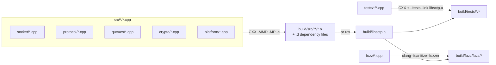
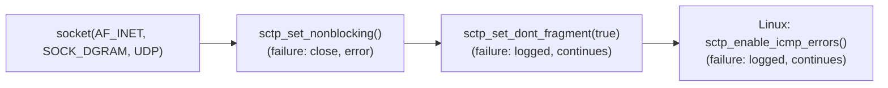

# 12. Build and platform

Sources: `Makefile`, `include/sctp/platform/compat.hpp`,
`include/sctp/platform/wakeup_pair.hpp`, `src/platform/wakeup_pair.cpp`,
`src/socket/api.cpp` (`open_udp_socket`).

- [Toolchain](#toolchain)
- [Make targets](#make-targets)
- [Build tree](#build-tree)
- [How a build is assembled](#how-a-build-is-assembled)
- [The platform layer](#the-platform-layer)
- [Socket setup](#socket-setup)
- [Feature matrix by platform](#feature-matrix-by-platform)

---

## Toolchain

- C++23 compiler and standard library: GCC 15 or newer, or Clang building
  against the same libstdc++. The code uses `std::ranges::to`,
  `append_range`, `std::views::zip`, `find_last_if`, `std::to_underlying`, and
  similar.
- No third-party dependencies. pthreads only (and `bcrypt` / `Ws2_32` on
  Windows, pulled in through `#pragma comment`).
- Flags: `-std=c++23 -Wall -Wextra -O2 -Iinclude -Isrc -pthread`.

---

## Make targets

| Target | Does |
|---|---|
| `make` / `make all` | library, examples (if any) and every test binary, into `build/` |
| `make lib` | `build/libsctp.a` only |
| `make test` | build, run every test binary, list the ones that failed |
| `make run` | build and run `examples/loopback` |
| `make asan` | rebuild with ASan + UBSan into `build/asan`, then `test run` (with `-k`) |
| `make tsan` | rebuild with TSan into `build/tsan`, then `test run` |
| `make fuzz` | clang + libFuzzer into `build/fuzz`, run each target `FUZZ_TIME` s |
| `make clean` | `rm -rf build/` |
| `make help` | this list |

Overrides: `CXX=clang++`, `OPT=-O0`, `BUILD=/tmp/out`, `FUZZ_TIME=600`.

> The Makefile builds `examples/*.cpp` by wildcard, and `make run` expects
> `examples/loopback.cpp`. The tree currently has no `examples/` directory, so
> that list is empty and `make run` has nothing to build.

---

## Build tree

```
build/                          ← everything the Makefile writes; nothing in-tree
├── libsctp.a
├── src/<module>/*.o, *.d       library objects + header dependency files
├── tests/<tier>/<name>         one executable per test source
├── examples/<name>
├── asan/   (same layout)       make asan
├── tsan/   (same layout)       make tsan
└── fuzz/                       make fuzz
    ├── fuzz/<target>
    ├── corpus/<target>/        grows across runs
    └── crashes/
```

---

## How a build is assembled



- `-MMD -MP` produces `.d` files that are `-include`d, so editing a header
  rebuilds only what depends on it.
- `-Itests` is added only for test binaries (`private INCLUDES += -Itests`),
  so the library cannot accidentally depend on `tests/support.hpp`.
- For fuzzing, the library itself is built with `-fsanitize=fuzzer-no-link`,
  so its coverage is traced too. `FUZZ_LDFLAGS=-L/usr/lib` stops clang from
  picking GCC's static `libstdc++.a`, which fails to link with the sanitizer
  runtimes.

---

## The platform layer

`compat.hpp` is the only file that includes `<winsock2.h>` or the POSIX socket
headers. Everything else includes `compat.hpp` and uses these names:

| Abstraction | POSIX | Windows |
|---|---|---|
| `sctp_socket_t` | `int` | `SOCKET` |
| `INVALID_SOCKET` / `SOCKET_ERROR` | `-1` / `-1` (defined here) | native |
| `sctp_pollfd`, `sctp_poll()` | `pollfd`, `poll()` | `WSAPOLLFD`, `WSAPoll()` |
| `SCTP_POLL_READ` | `POLLIN` | `POLLRDNORM` |
| `sctp_platform_startup()` / `cleanup()` | no-op | `WSAStartup` / `WSACleanup` (refcounted) |
| `sctp_close_socket()` | `close()` | `closesocket()` |
| `sctp_last_error()` / `sctp_set_last_error()` | `errno` | `WSAGetLastError()` / `WSASetLastError()` |
| `sctp_error_would_block()` | `EAGAIN` / `EWOULDBLOCK` | `WSAEWOULDBLOCK` |
| `sctp_error_too_big()` | `EMSGSIZE` | `WSAEMSGSIZE` |
| `sctp_error_interrupted()` | `EINTR` | `WSAEINTR` |
| `sctp_set_nonblocking()` | `fcntl(O_NONBLOCK)` | `ioctlsocket(FIONBIO)` |
| `sctp_set_dont_fragment(s, on)` | Linux: `IP_MTU_DISCOVER` `PROBE`/`DONT`. Other POSIX: unsupported. | `IP_DONTFRAGMENT` |
| `sctp_enable_icmp_errors()` | Linux: `IP_RECVERR`. Other POSIX: unsupported. | unsupported |
| `sctp_parse_ipv4()` | `inet_pton(AF_INET)` | same |
| `random_bytes()` | `getrandom()` | `BCryptGenRandom()` |

`Wakeup_Pair` (see [Concurrency](02-concurrency.md#waking-the-wakeup-pair)) is
also platform code. It uses a loopback UDP pair rather than a pipe, because
`WSAPoll` accepts only sockets.

---

## Socket setup

Every UDP socket the stack opens goes through `open_udp_socket()`:



The constructor opens the first socket. `sctp_bindx` binds it and opens one
more socket per additional address. If any step of `sctp_bindx` fails, every
socket is closed and the object becomes unusable: later calls return
`false` or `NOT_RUNNING`.

---

## Feature matrix by platform

| Feature | Linux | Windows | Other POSIX |
|---|:-:|:-:|:-:|
| Core protocol, multi-homing, streams | ✔ | ✔ | ✔ |
| DF set on DATA / probes | ✔ (`IP_PMTUDISC_PROBE`) | ✔ | ✗ |
| DPLPMTUD by probing | ✔ | ✔ | probes may be fragmented by IP instead of lost |
| ICMP Packet Too Big hints | ✔ | ✗ | ✗ |
| `ip_fragment` retransmissions (DF off) | ✔ | ✔ | n/a |
| Kernel interop test | ✔ | SKIPPED | depends on kernel SCTP |
| IPv6 | ✗ (not implemented) | ✗ | ✗ |
