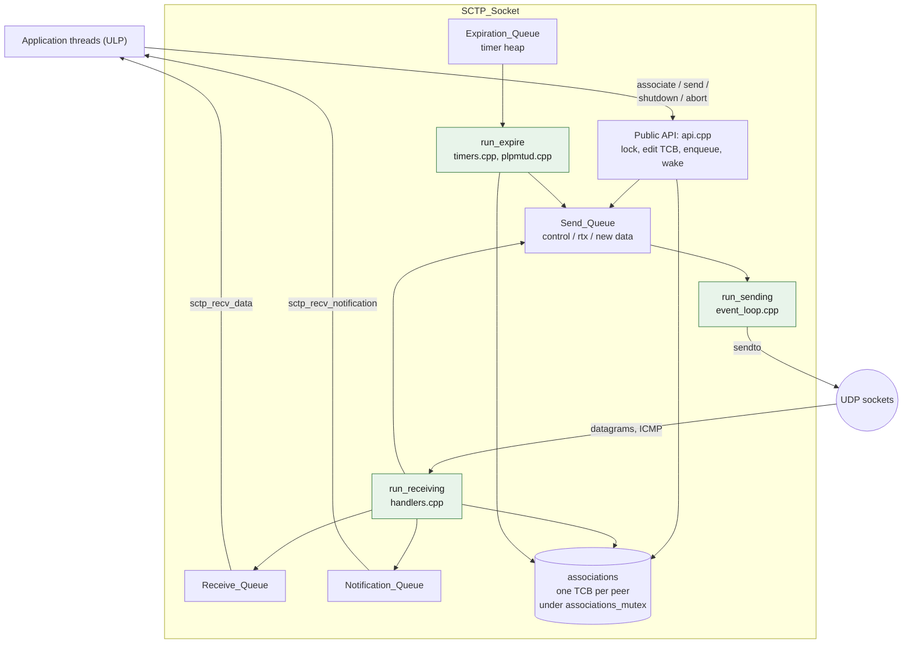
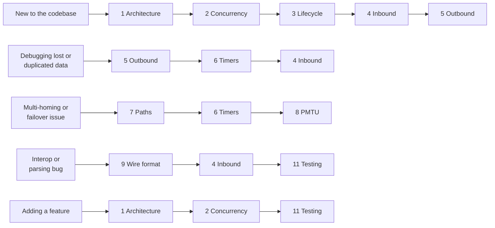

# sctp_stack: developer documentation

These docs explain how the stack is built: first the overall architecture, then
each subsystem in detail. They are written for someone who knows RFC 9260 and
wants to learn how this code implements it. If you are reading the code for the
first time, read the documents in order. If you are looking into a specific
behaviour, use the index below.

> **What the stack is.** A userspace SCTP implementation (RFC 9260) carried over
> UDP encapsulation (RFC 6951), written in C++23. It builds as one static library
> (`libsctp.a`) for Linux and Windows and links nothing except pthreads. CRC-32C,
> SHA-256 and HMAC are implemented in-tree.

Diagrams are [Mermaid](https://mermaid.js.org/), which renders natively on
GitHub, GitLab and in most editors. Wire layouts use RFC-style ASCII.

---

## The whole system on one page

Green boxes run on the event loop thread. Everything else is shared state, or code that runs on
the caller's thread.

---

## Index

| # | Document | Covers | Main sources |
|---|---|---|---|
| 1 | [Architecture](01-architecture.md) | Module layers, ownership, the TCB, API-to-internals map, notifications | `include/sctp/*`, `src/socket/api.cpp` |
| 2 | [Concurrency and the event loop](02-concurrency.md) | Threads, the lock model, one loop pass, wakeups, the peek/commit send cycle, close | `src/socket/event_loop.cpp`, `src/platform/` |
| 3 | [Association lifecycle](03-association-lifecycle.md) | State machine, four-way handshake, collisions and restarts, stale cookies, shutdown, abort | `src/socket/handlers.cpp`, `api.cpp` |
| 4 | [Inbound path](04-inbound.md) | Packet validation, tag rules, OOTB handling, dispatch, DATA reception, reassembly, ordering, SACK generation | `src/socket/handlers.cpp` |
| 5 | [Outbound path and congestion control](05-outbound.md) | Send queue tiers, late TSN assignment, bundling and fragmentation, SACK processing, cwnd/rwnd, fast retransmit, T3-rtx | `event_loop.cpp`, `handlers.cpp`, `timers.cpp`, `src/queues/send_queue.cpp` |
| 6 | [Timers](06-timers.md) | The generation-stamped timer heap, every timer type, RTO estimation, back-off, error counters | `src/queues/expiration_queue.cpp`, `timers.cpp` |
| 7 | [Paths, multi-homing and encapsulation](07-paths.md) | Keys and aliases, path selection, confirmation, heartbeats, failover, multiple local addresses, UDP ports | `src/socket/internal.hpp`, `timers.cpp`, `api.cpp` |
| 8 | [PMTU discovery](08-pmtu.md) | DPLPMTUD state machine, search, black holes, ICMP Packet Too Big, PMDCS/AMDCS | `src/socket/plpmtud.cpp` |
| 9 | [Wire format](09-wire-format.md) | In-memory packet model, codec, checksum byte order, TLVs, builders, serial arithmetic | `src/protocol/` |
| 10 | [State cookies and crypto](10-cookies-and-crypto.md) | Cookie layout, signing and verification, secret rotation, tie-tags, randomness | `src/crypto/` |
| 11 | [Testing](11-testing.md) | Test tiers, the in-process RFC harness, requirement traceability, interop, fuzzing, sanitizers | `tests/`, `fuzz/` |
| 12 | [Build and platform](12-build-and-platform.md) | Makefile, build tree, Winsock/POSIX compatibility layer | `Makefile`, `include/sctp/platform/` |
| - | [Glossary](glossary.md) | Abbreviations and names used in the code and these docs | |

## Suggested reading paths

## Conventions in these docs

- **§x.y** refers to a section of RFC 9260 unless another RFC is named
  (RFC 6951 is UDP encapsulation, RFC 8899 is DPLPMTUD, RFC 4820 is the PAD chunk).
- `file.cpp: function()` points at code. Paths are relative to the repository root.
- "TCB" and `Association` mean the same thing: the per-association state of
  §14.
- "ULP" is the application using the library.
- Identifiers such as `COOKIE_ECHOED` or `T3_RTX` are spelled as they are in the code.
